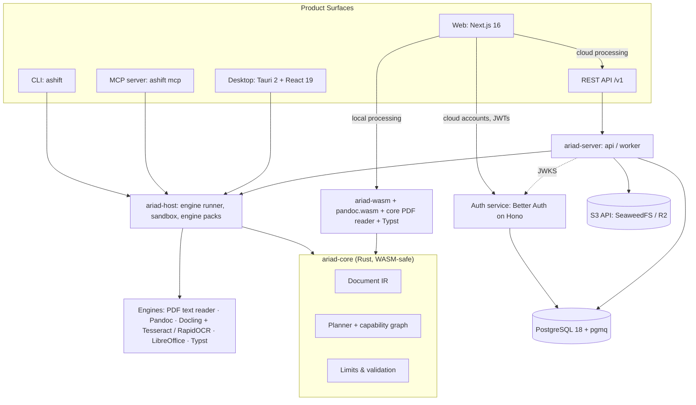

# AriadShift — System Architecture

> **Status:** Proposal v1 · **Updated:** 2026-10-23
> Version selections are based on registry and release checks recorded on 2026-10-06; the web rows in §2.2 and the wasm rows in §2.3 were re-verified on 2026-10-22. Lockfiles pin exact resolved versions.

AriadShift is an open-source, local-first document transformation platform. A single core engine powers five surfaces: **CLI, Desktop, Web, REST API/SDK, and MCP server**.

The name is derived from Ariadne's thread: AriadShift's planner navigates the format "labyrinth," just as Ariadne's thread guided Theseus out of the maze.

**Three product differentiators:**

1. **Private by default.** Browser and desktop process first; cloud is an option, not the default.
2. **Measurable quality.** Every conversion route has a score generated from public benchmarks, never hand-coded.
3. **AI agent ready.** Any document → clean Markdown/JSON via MCP, immediately usable as LLM context.

---

## 1. Architectural Principles

| # | Principle | Concrete Implications |
|---|---|---|
| 1 | One core, multiple surfaces | CLI, Desktop, Web, API, and MCP invoke the same `ariad-core`; no surface contains dedicated conversion logic |
| 2 | IR-centric (hub-and-spoke) | N readers + M writers instead of N×M converters; adding a format requires only a single adapter |
| 3 | Out-of-process engines, uniform protocol | All untrusted file parsing runs in sandboxed child processes; an engine crash never crashes the host app |
| 4 | Local-first | Priority order: browser → desktop/CLI → cloud |
| 5 | Evidence over claims | Fidelity and speed scores for each route are generated from `bench/`, where the planner reads them |
| 6 | Secure by default | Resource limits, decompression bomb prevention, no network access for engines, no content logging |
| 7 | First-class self-hosting | `docker compose up` runs the complete stack with zero external cloud accounts required |
| 8 | License clean | Apache-2.0 project; no AGPL in distribution; CI blocks invalid licenses |
| 9 | No lock-in | Open standards at every boundary: S3 API, OpenAPI 3.1, JWT/JWKS, OpenTelemetry, MCP |

Native Markdown and HTML parsing in `ariad-core` run in-process as explicit exceptions to Principle 3. The I/O-free PDF reader also compiles for browser WASM; native surfaces always run it through the isolated PDF engine. These readers are pure Rust with `#![forbid(unsafe_code)]`, typed errors, and finite nesting, node, and block limits; core readers are fuzzed starting in roadmap 1a. The DoclingDocument JSON mapper (`ariad_core::docling`) joins them: it reads the JSON that the out-of-process Docling engine wrote, never the user's input file, under the same bounds, typed errors and fuzzing (`docling_to_ir`). Every other parser runs out of process.

---

## 2. Versioning Policy

- Components **with an LTS channel** → use the **latest LTS**.
- Components **without LTS** → use the **latest stable release**.
- **Do not use** alpha, beta, or RC builds, even when available (e.g., Tauri 3 alpha, PostgreSQL 19 beta).
- Pin exact versions via lockfiles (`pnpm-lock.yaml`, `Cargo.lock`, `uv.lock`). Renovate opens weekly update PRs; patch releases automerge when CI passes.

### 2.1 Runtimes and Platforms

| Component | Pinned Version | Channel | Notes |
|---|---|---|---|
| Node.js | **24.x "Krypton"** (24.21) | LTS | Node 26 enters LTS on **2026-10-28** → upgrade immediately after that date. Node 24 is maintained until 2028-04-30 |
| Rust | **1.99** stable, edition 2024 | Stable (Rust has no LTS) | Pinned via `rust-toolchain.toml` |
| Python | **3.14.x** | Stable, supported until 2030-10 | Python has no LTS; 3.15 is unreleased |
| PostgreSQL | **18.x** (18.6) | Major supported until 2030-11 | 19 is in beta |
| Ubuntu (Docker image, CI) | **26.04 LTS** "Resolute Raccoon" | LTS | Single base image for all containers |
| GitHub Actions runners | `ubuntu-26.04`, `macos-26`, `windows-2025` | GA | Pin labels explicitly; `ubuntu-latest` remains 24.04 until November 2026 |
| LibreOffice | **26.8.x** | Longest-supported line currently available (until 2027-06) | LibreOffice has no LTS; 26.2 expires 2026-11-30 |

### 2.2 Web and Desktop

| Component | Version | Notes |
|---|---|---|
| Next.js | **16.4.2** | Newest release of the 16 LTS line (verified 2026-10-22); Next 15 reached end of support on 2026-10-21 |
| React | 19.3.1 | |
| TypeScript | **7.0.2** (native Go compiler) | 8–12x faster. Next 16.3+ type-checks through the project-local `tsc` CLI by default (`experimental.useTypeScriptCli`), so no fallback is needed; JS API available from 7.1 |
| Vite | 8.3 (Rolldown bundler) | Used for desktop |
| Tailwind CSS | 4.3.3 | Through `@tailwindcss/postcss` |
| shadcn/ui | CLI 4.22.1, **Base UI** style `base-nova` (`@base-ui/react` 1.9.0) | Base UI has been the shadcn default since 07/2026 |
| Tauri | **2.12** | Tauri 3 is in alpha → not yet adopted |
| TanStack Query / Zustand / Zod | 5 / 5 / 4 | Server state / UI state / schema |
| React Hook Form / Motion / lucide-react | 7 / 14 / 1.x | |
| Uppy | 6 (+ `@uppy/aws-s3`) | Resumable multipart uploads |
| Better Auth | 1.7 (1.7.12) | Runs in the separate auth service `services/auth` on Hono 4.13 (`@hono/node-server` 2.1) and `pg` 8, with the JWT, API Key (`@better-auth/api-key`), Passkey (`@better-auth/passkey`) and two-factor plugins |
| `@hey-api/openapi-ts` | 0.99.0 | Generates the `packages/sdk` client from `schemas/openapi.v1.json` at build time. The generator imports the TypeScript compiler API, which TS 7 does not publish, so the SDK package aliases `typescript` to `@typescript/typescript6` 6.0.2 and type-checks with TS 7 |
| pnpm | 12 | Workspace + catalog |
| Biome | 2.6.2 | Single-binary linter + formatter; independent of TypeScript JS APIs |
| Vitest / Playwright | 5.0.5 / 1.64.1 | Playwright runs Chromium, Firefox and WebKit |
| Lighthouse | 13.5.0 | Local `just web-lighthouse`; scores in [docs/web.md](docs/web.md) |

### 2.3 Rust Crates

| Crate | Version | Role |
|---|---|---|
| tokio | **~1.53** | **LTS line until 2027-09** (pinned to minor with `~`) |
| axum / tower / tower-http | **0.8.9** / **0.5.3** / **0.7.1** | HTTP API (`ariad-server`) |
| sqlx | **0.9.0** (`postgres`, `runtime-tokio`, `tls-rustls-ring-native-roots`, `chrono`, `uuid`, `json`, `migrate`, `macros`) | Postgres pool, embedded migrations; runtime-checked queries covered by integration tests |
| object_store | **0.14.2** (`aws-base`, `reqwest`, `ring`, `fs`) | Unified API for S3, R2, GCS, Azure, and local disk; presigned URLs. The `aws` feature is not used because it forces `aws-lc-rs` |
| utoipa / utoipa-axum | **6.0.0** / **0.3.0** | OpenAPI 3.1 generation from code |
| tracing / opentelemetry | 0.1 / **0.33.1** | Observability |
| tracing-subscriber / opentelemetry_sdk / opentelemetry-otlp / tracing-opentelemetry | **0.3.23** / **0.33.1** / **0.33.1** (`http-proto`, `reqwest-client`) / **0.34.0** | Server logs and optional OTLP export |
| reqwest / rustls | **0.13.5** (`rustls-no-provider`) / **0.23.46** (`ring`) | Outbound HTTP from the server (JWKS, Turnstile, S3); ring is installed as the process crypto provider |
| chrono / hmac / async-trait / tokio-stream / futures-util / bytes / url | **0.4.45** / **0.13.0** / **0.1.92** / **0.1.19** / **0.3.34** / **1.12.1** / **2.5.8** | Server timestamps (sqlx has no `jiff` support), signed local blob URLs, the `JobQueue` trait, SSE streams |
| serde / thiserror / clap / schemars / jiff / uuid | 1 / 2 / 4.6 / 1.2 / 0.2 / 1 | Common foundational utilities |
| lopdf | **0.46.0**, default features off; `wasm_js` on wasm32 | Base PDF text-layer reader, MIT; PDFium remains inside the Docling pack and benchmark rendering only |
| typst / typst-pdf | **0.15.1** | IR → PDF in an out-of-process engine; embedded OFL fonts |
| rmcp | **3.5.1** (`default-features = false`, `server`, `macros`, `transport-io`) | Official MCP SDK for Rust |
| wasm-bindgen / wasm-bindgen-cli / js-sys | **0.2.129** / **0.2.129** / **0.3.106** | Build `ariad-wasm`; the CLI comes from its release archive with checksums pinned in `scripts/install-wasm-bindgen.sh` and must equal the crate version |
| jsonwebtoken | **11.1.0** (`rust_crypto`) | JWT verification from Better Auth |
| ts-rs | 12.0.1 (`serde-compat`) | Generated desktop IPC types and command wrappers |
| comrak | **0.56.0** (`default-features = false`, `shortcodes`) | CommonMark/GFM Markdown reader in `ariad-core`; BSD-2-Clause |
| html5ever | **0.40.1** (MIT OR Apache-2.0) | Native HTML reader in `ariad-core` |
| process-wrap | **10.0.1** (`tokio1`, `process-group`, `job-object`) | Cross-platform engine process-tree control |
| tokio-util | **0.7.20** | Bounded NDJSON line framing |
| unicode-normalization | **0.1.25** | NFC normalization of prose text |
| sha2 | **0.11.1** | SHA-256 asset identifiers and golden hashes |
| base64 | **0.23.1** | JSON asset bytes and embedded image data URLs |
| cap-std | **4.0.3** | Capability-based asset file access |
| zip | **9.0.5** | Runtime DOCX metadata rewrite; also used by goldens |
| serde_stacker | **0.1.14** | Deep IR JSON reads in the native host |
| serde_json | **1.0.154** (`unbounded_depth` in the host) | IR and protocol JSON |
| tempfile | **3.27.0** | Isolated conversion workspaces |
| saphyr-parser | **0.2.2** (MIT OR Apache-2.0) | Pure-Rust YAML 1.2 event parser; its `Alias` events let the reader reject aliases before interpreting front matter; wasm compatibility is checked in phase 4 |
| ureq | **3.5.0** (`default-features = false`, `rustls-no-provider`) | Blocking HTTPS client for engine pack downloads: connect and idle-read timeouts, proxy variables; native targets only |
| rustls + ring | **0.23.46** + **0.17.14** | TLS for pack downloads; ring is selected explicitly through the client configuration and builds with the musl C toolchain the release already uses for `psm` |
| rustls-native-certs | **0.8.5** | Trust anchors from the operating system store (`SSL_CERT_FILE`/`SSL_CERT_DIR` on Linux) |
| minisign-verify | **0.3.0** (MIT) | Engine pack manifest signatures (prehashed minisign) |
| tar / ruzstd / flate2 | **0.4.46** (`default-features = false`) / **0.9.1** / **1.1.10** (`zlib-rs`) | Pure-Rust pack archive readers (`tar.zst`, `tar.gz`); `zip` covers `.zip` |
| directories | **6.0.0** | Platform data directory for packs; its `option-ext` 0.2.0 dependency is MPL-2.0 (per-crate exception) |
| semver | **1.0.28** | Pack versions and `requires_ashift` |
| toml | **1.1.8+spec-1.1.0** | Pack manifests, receipts and the pack index in `ariad-host`; fixture and test validation |
| Dev-only test crates | insta **1.49.0** (`json`, `glob`), jsonschema **0.58.6**, assert_cmd **2.2.2**, quick-xml **0.42.0**, hex **0.4.3**, minisign **0.10.0** (throwaway pack signing keys), rcgen **0.14.10** (`ring`, throwaway TLS certificates) | Test and fixture validation only; never distributed |

### 2.4 Engines and Infrastructure

| Component | Version | License | Role |
|---|---|---|---|
| Docling | 2.142.0 (`docling-slim` extras; `docling-core` 2.104.0, DoclingDocument schema 1.10.0) | MIT (weights: Apache-2.0 / CDLA-Permissive-2.0 / MIT) | Structural document parsing for PDF, images, DOCX/PPTX/XLSX (Heron layout, TableFormer); OCR uses Docling's Tesseract CLI option (`TesseractCliOcrOptions`), not the `tesserocr` binding (no Windows wheel, bundles Tesseract 5.5.1, pulls in LGPL cysignals); the pack uses CPU-only PyTorch 2.14.1 on Linux and Windows and runs on CPython 3.14.9 from python-build-standalone |
| Granite-Docling | 258M | Apache-2.0 | English complex layouts; ja/ar/zh are experimental; not used for Vietnamese |
| RapidOCR + ONNX Runtime | 3.10.0 + 1.31.0 | Apache-2.0 / MIT | PP-OCRv6 OCR for English, Chinese, Japanese, and most Latin languages; never route Vietnamese here |
| Tesseract + `tessdata_best` | 5.5.3 + `vie`/`eng`/`osd` | Apache-2.0 | Default OCR for Vietnamese and mixed Vietnamese-English. The docling pack ships the pinned traineddata and `configs/tsv`; the Tesseract 5 program comes from the system and `ashift doctor` reports it |
| PaddleOCR-VL | 1.6 (0.96B; via llama.cpp) | Apache-2.0 / MIT | Optional high-accuracy OCR path |
| Pandoc | **3.12** (official `pandoc.wasm` available) | GPL-2.0+ | Install the official release binary with SHA-256 verification via `scripts/install-pandoc.sh`; the Arch package is 3.11. Hub for DOCX, ODT, EPUB, HTML, LaTeX, and RST |
| FFmpeg | 9.0, LGPL build | LGPL-2.1+ | Audio/video (later phase) |
| libvips | 8.x | LGPL-2.1+ | Large images, batch processing |
| pgmq | 1.13.1 | PostgreSQL License | In-Postgres job queue; tests use `ghcr.io/pgmq/pg18-pgmq:v1.13.1` (PostgreSQL 18.6) |
| NATS | 2.15 | Apache-2.0 | Queue adapter for high-scale needs |
| SeaweedFS | 4.x (4.48 in tests) | Apache-2.0 | Self-hosted S3 (MinIO archived 04/2026) |
| Cloudflare R2 | — | Managed service | Object storage for hosted tier |
| uv / ruff | 0.12 / 0.16 | MIT | Python environment management and linting |
| Fixture generator | Exact versions in `uv.lock` | Permissive | python-docx, Pillow, and typst-py are development-only and never distributed |

---

## 3. System Overview



---

## 4. Product Surfaces

| Surface | Target Users | Runtime Location | Available Engines |
|---|---|---|---|
| **CLI** `ashift` | Developers, scripts, CI | Local machine | All installed engines |
| **MCP** `ashift mcp` (stdio) | AI agents: Claude, Cursor, IDEs | Local machine | Same as CLI |
| **Desktop** | Privacy-focused users, large files, batch | Local machine | All, installed via engine packs |
| **Web, Local Mode** | General users | Browser (WASM) | core, Pandoc WASM, core PDF reader, Typst |
| **Web, Cloud Mode** | Complex files, scans, legacy Office | Server workers | All |
| **REST API + TS SDK** | Developers, enterprises | Server | All |

Representative CLI commands:

```bash
ashift convert notes.md --to docx
ashift inspect scan.pdf          # PDF type, page count, tables, OCR requirement
ashift plan paper.pdf --to docx  # explain the selected route and rationale
ashift engines                  # installed engines, versions, licenses
ashift engines install docling  # download engine pack
ashift doctor                   # check environment
ashift mcp                      # run MCP server over stdio
```

The conversion command is `ashift convert <INPUT>… --to <FORMAT> [-o <OUTPUT>] [--overwrite] [--profile <PROFILE>] [--engine <ENGINE>] [--json]`. With several inputs, `-o` must name an existing directory; results keep input order, human output has one path per success, and JSON has a `results` array containing successes and typed failures. The command continues after individual failures and returns the first failure's exit code (130 on cancellation). Batch jobs share a warm engine pool; one input preserves the single-document output contract. It supports `md`/`markdown`, `html`, `docx`, and `epub` to/from IR JSON (`--to json`), PDF text extraction through the built-in PDF reader, and IR → PDF through Typst. System LibreOffice adds DOC/RTF/ODT → DOCX, XLS/ODS → XLSX, PPT/ODP → PPTX, and all ten Office/ODF formats → PDF. The executor chains any number of registered steps, so DOC → DOCX → IR → Markdown works. PDF reader selection is content-aware: the bounded built-in engine reads digital text once and its result is reused; `needs_ocr` selects Docling. `--engine` pins the input reader, including Docling layout extraction for digital PDFs, without constraining later writers. Reader choice and OCR requirements never silently fall back to another reader. `inspect` uses only the built-in PDF path. LibreOffice is optional; DOCX → PDF falls back to Pandoc → IR → Typst when it is absent. The default output is `<input stem>.<target extension>` beside the input. Same-format routes (such as `md -> md`) are refused with exit code 3; destinations that canonicalize to the input path are refused with exit code 2 even when `--overwrite` is specified. In Markdown and HTML writers, asset-backed images are embedded as `data:` URIs so output remains a single file. `ashift mcp` confines file access to client roots plus `--allow-dir` paths; overwriting needs the server flag `--allow-overwrite`.

Diagnostic and introspection commands:
- `ashift inspect <INPUT> [--json]`: detects format through prefix/central-directory sniffing, structural element counts, metadata, and reachable targets. Regular-file verification prevents blocking on FIFOs or device nodes; files over 32 MiB skip deep structural counting (emitting `warning[document_too_large]`). Peak memory usage during AST expansion is bounded to approximately 100x the input document size.
- `ashift plan <INPUT> --to <FORMAT> [--profile <PROFILE>] [--json]`: renders route and fidelity/editability/latency scores without converting. File summaries are bounded to 4 MiB to keep planning fast.
- `ashift engines [--json]`: lists registered engines, versions, licenses, and supported routes from the availability provider.
- `ashift doctor [--json]`: checks Pandoc availability and version, temporary workspace creation/cleanup, reports stale workspace counts without deleting them, engine describe round trips, and sandbox mode, Landlock ABI and seccomp availability; non-required checks report the engine pack data directory, the compiled-in pack signing keys and each installed pack.
- `ashift engines install <NAME> [--version <V>] [--manifest <URL|PATH> | --from <DIR>] [--json]`, `ashift engines remove <NAME> [--version <V>]` and `ashift engines verify <NAME> [--version <V>]` manage signed engine packs (§7.1, [docs/packs.md](docs/packs.md)). `ashift engines` lists installed packs; MCP `list_engines` includes them, but installing stays a CLI and desktop operation.

### Model Context Protocol (MCP) Server

`ashift mcp [--allow-dir <DIR>...] [--allow-overwrite]` runs an MCP server over standard I/O (stdio) using `rmcp 3.5.1`. It exposes four tools (`list_engines`, `inspect`, `plan`, `convert`) whose structured output schemas match their CLI JSON equivalents and returns `structuredContent` matching CLI `--json` value-for-value:
- **Confinement and Security**: Enforces path confinement (`ariad_host::confine`). File access is confined to `--allow-dir` roots and client-advertised workspace roots synchronized via `roots/list` and `notifications/roots/list_changed`. Rejects symlink/junction escapes, hidden path components, non-regular inputs, mismatched output extensions, and same-file input/output collisions. Relative paths resolve against the server's working directory.
- **Capability-Based Promotion**: Conversions write outputs inside isolated workspaces (`ariad_host::workspace`) and promote them into the destination using `cap_std::fs::Dir` capability handles opened relative to the confined root to mitigate race-condition directory swap attacks. Replacing existing files requires `--allow-overwrite` on the server and `overwrite: true` on the tool call; unforced publication uses hard-link creation to guarantee atomic refusal without clobbering.
- **Resources & Inlining**: Successful conversions register `file://` URIs for `resources/read`. Markdown outputs `<= 256 KiB` are inlined directly into tool results.
- **Process Isolation & Lifecycle**: Subprocess engines run under isolated process groups and Windows Job Objects with `KillOnDrop`, with the Linux sandbox described in §11.3. One shared session pool keeps session-capable engines warm across tool calls (5-minute idle timeout, 100 jobs per process, at most two idle sessions per engine command); shutdown closes the pool. Stale workspaces older than 24 hours are swept on server startup and stale counts reported in `doctor`. SIGTERM, SIGHUP, Ctrl-C, and Ctrl-Break promptly cancel in-flight jobs, terminate engine subprocess trees, clean up workspaces, and exit cleanly without hanging on open stdin.

| Exit code | Meaning |
|---|---|
| 0 | ok |
| 1 | conversion / operation failed |
| 2 | usage |
| 3 | unsupported route (prints the supported routes) or unknown format |
| 4 | limit exceeded |
| 5 | tool missing, wrong version, or required sandbox unavailable (prints a hint) |
| 6 | destination exists |
| 130 | interrupted |

Warnings are written to stderr as `warning[<code>]: <message>`. Progress is written to stderr only when stderr is a TTY. Stdout contains human output (or the output path for `convert`), or exactly one JSON document when `--json` is specified. SIGTERM and SIGHUP (Unix), Ctrl-C, and Ctrl-Break (Windows) cancel the run, kill the engine process tree, delete the workspace, return 130, and leave the destination untouched. Failures never leave partial output; `--overwrite` replaces the destination only after a successful conversion. `ASHIFT_PANDOC` selects the Pandoc executable; `ASHIFT_SOFFICE` selects a system LibreOffice (>=24.2); `SOURCE_DATE_EPOCH` fixes Typst PDF, DOCX and EPUB timestamps for reproducible goldens. Commands reuse the same exit-code table. Full reference: [docs/cli.md](docs/cli.md) and [docs/mcp.md](docs/mcp.md).

---

## 5. Monorepo Structure

```text
ariadshift/
├── ARCHITECTURE.md
├── Cargo.toml                 # Cargo workspace
├── rust-toolchain.toml        # Rust 1.99
├── pnpm-workspace.yaml        # pnpm workspace + shared version catalog
├── pyproject.toml             # uv workspace
├── justfile                   # root entry point: fmt, lint, test, wasm, deny, js, py, pandoc, ci, web-*
├── .node-version              # 24
├── scripts/                   # pinned tool installers
├── .tools/                    # gitignored local tools
├── crates/
│   ├── ariad-core/            # IR, format registry, planner, limits (I/O-free, WASM-compilable)
│   │   └── data/capabilities.json # committed bootstrap & bench capabilities
│   ├── ariad-host/            # engine runner, sandbox, engine packs, native adapters (feature flags)
│   │   └── data/              # packs.toml (pack index) and pack-keys/*.pub (trusted signing keys)
│   ├── ariad-cli/             # `ashift` binary (includes `ashift mcp`)
│   ├── ariad-wasm/            # wasm-bindgen bindings for ariad-core (browser JS API)
│   ├── ariad-typst/           # shared in-memory Typst compiler, fonts and lazy browser module
│   └── ariad-server/          # `ariad-server api | worker` binary
├── engines/
│   └── docling/               # Python engine (uv project) implementing the engine protocol
├── apps/
│   ├── web/                   # Next.js 16: website + in-browser converter (docs/web.md)
│   └── desktop/               # Vite 8 + React 19
│       └── src-tauri/         # Tauri 2, depends on ariad-host
├── packages/
│   ├── ui/                    # shared React components (shadcn + Base UI), brand theme
│   ├── ariad-wasm/            # generated ariad-wasm bindings (built by `just wasm-build`, not committed)
│   ├── sdk/                   # TypeScript SDK generated from OpenAPI at build time (generated code not committed)
│   └── config/                # tsconfig, Biome presets
├── services/
│   └── auth/                  # Better Auth on Hono: accounts, JWT/JWKS and API keys for the cloud
├── schemas/                   # openapi.v1.json (generated by `just openapi`) and JSON Schema: IR, engine protocol, capabilities.v0.json, pack.v1.json (generated with schemars)
├── fixtures/
│   ├── manifest.toml          # source, license and digest for each committed document
│   ├── gen/                   # dev-only Python fixture generator; uv workspace member
│   └── golden/                # generated IR and DOCX snapshots
├── bench/                     # benchmark harness → capabilities.json
├── infra/
│   ├── compose/               # docker-compose.yml for self-hosting
│   ├── docker/                # server, worker-office, worker-docling and static web Dockerfiles
│   └── test/                  # SeaweedFS identity for the server tests
├── brand/                     # code-generated logo and icons
└── docs/
```

The `justfile` provides `fmt`, `lint`, `test`, `wasm`, `deny`, `js`, `py`, `pandoc`, `ci`, `bench`, `bench-check`, `bench-test`, and `fixtures`, plus `wasm-build`, the `web-*` recipes for the web app (`web-dev`, `web-build`, `web-export`, `web-test`, `web-e2e`, `web-lighthouse`; see [docs/web.md](docs/web.md)), `openapi`, and `sdk-generate`/`sdk-check` for the SDK.

Only 5 crates exist initially. Further crate splits occur only when distinct boundaries emerge, such as an adapter requiring an independent release cycle.

---

## 6. Core

### 6.1 Crate Responsibilities

| Crate | Responsibility | WASM | Key Dependencies |
|---|---|---|---|
| `ariad-core` | IR types, format registry, planner, limit enforcement, pure-data engine-protocol message types shared with host, browser, and server, native Markdown and HTML readers/writers, PDF text reader, Typst markup writer, Pandoc mapping and in-memory package metadata stamping, the in-memory pipeline (`pipeline`: read, write and run in-process routes by format id, with bounded IR JSON input) and in-memory inspection (`inspect`) | ✓ | serde, schemars, lopdf |
| `ariad-host` | Asset resolution, engine process execution, workspaces, engine pack management, PDF/Pandoc/LibreOffice/Docling/Typst adapters, and native package metadata I/O | ✗ | tokio, ariad-typst |
| `ariad-cli` | Command-line interface, MCP server | ✗ | clap, rmcp |
| `ariad-wasm` | Browser JS API: `version`, `capabilities`, `inspect`, `plan`, `convert` over format ids and the `wasm` capability edges; internal `readPandoc`, `writePandoc` and `stampPackage` bridges to core; typed error objects; no conversion logic of its own | ✓ | wasm-bindgen, js-sys |
| `ariad-typst` | In-memory Typst compilation and the embedded Libertinus/Source Code Pro fonts, shared by the host and a separate lazily loaded browser module | ✓ | typst, typst-pdf, wasm-bindgen |
| `ariad-server` | `api`: Axum + OpenAPI; `worker`: consumes jobs from pgmq and calls ariad-host | ✗ | axum, sqlx, object_store |

### 6.2 Document IR

The IR serves as the "lingua franca" across readers and writers. Designed in three layers, the layout layer is entirely optional:

The frozen document schema is `ariad-ir/1` at `schemas/ir.v1.json`. Native and in-memory readers continue accepting `ariad-ir/0`, preserving its content and upgrading the version on output. `schemas/ir.v0.json` remains available for existing documents. Unknown or missing versions are rejected. Breaking changes require a new major wire version.

Every enum variant is a struct variant serialized with an internally tagged `type` field and a snake_case tag, for example `{"type":"paragraph","content":[...]}`. This is required for Serde's internally tagged representation and avoids tuple or newtype variants. Format variants serialize with a single wire identity matching `Format::id()` (for example `ariad-ir+json` and `pandoc+json`). In addition to `Markdown`, `Html`, and `Docx`, the format registry provides `Epub`, `Pdf`, and `Png` (required by the spike for image inputs and source-format deserialization without a reader in 1a).

New IR fields follow the rule: **omit when empty** (`#[serde(default, skip_serializing_if = ...)]`). Existing fields keep their current `null` serialization. IR goldens change only the document version at the v1 freeze. EPUB identifiers derive from the IR byte hash, so their identifiers and dependent table-of-contents hashes also change.

`Document` has `{ version, meta, body, assets, layout, provenance, furniture }`. `furniture: Vec<Block>` carries running page headers and footers outside `body` and is omitted when empty. `Metadata` has `{ title, authors, language, date, subject, keywords, source_format }`.

`LayoutIndex` specifies page geometry plus per-block bounding boxes: `{ pages, blocks }`. Coordinates (`left`, `top`, `right`, `bottom`) and dimensions (`width`, `height`) use typographical points (pt, 1/72 inch) with origin `(0, 0)` at the top-left of each page. Blocks are keyed by stable `/`-separated block paths where path segments match real AST field names and compose recursively for arbitrary nesting:
- Top-level body blocks: `"body/<index>"` (e.g. `"body/0"`).
- Furniture blocks: `"furniture/<index>"` (e.g. `"furniture/0"`).
- Nested quote blocks: `"body/<index>/blocks/<block_index>"`.
- Nested footnote blocks: `"body/<index>/blocks/<block_index>"`.
- Nested list item blocks: `"body/<index>/items/<item_index>/blocks/<block_index>"`.
- Nested table cell blocks: `"body/<index>/head/<row_index>/cells/<cell_index>/blocks/<block_index>"` or `"body/<index>/body/<row_index>/cells/<cell_index>/blocks/<block_index>"`.

Paths compose recursively across container boundaries (for example, a list item inside a quote is `"body/<index>/blocks/<block_index>/items/<item_index>/blocks/<inner_block_index>"`). Each block position entry contains `{ page_no, bbox: { left, top, right, bottom } }`. `LayoutIndex` is omitted when empty. Old free-form layout objects (such as arbitrary JSON maps) are ignored under the `ariad-ir/0` draft; layout content must conform to the `LayoutIndex` schema.

`Block` variants and fields are:

- `Heading { level, content }`, `Paragraph { content }`, `Code { lang, text }`, `Math { tex, display }`, `Quote { blocks }`, and `PageBreak {}`.
- `List { ordered, start, tight, items }`, where each `ListItem` is `{ checked, blocks }`.
- `Table { caption, columns, head, body, footnotes }`, with `ColumnSpec { align }`, cells `{ rowspan, colspan, header, blocks }`, and `footnotes: Vec<Inline>` (omitted when empty). `TableCell.header: Option<bool>` models row headers / stub columns and is omitted when None.
- `Figure { asset, caption }`, `Footnote { id, blocks }`, and `Raw { format, text }`.

`Inline` variants are `Text { text }`, `Emph { content }`, `Strong { content }`, `Strikeout { content }`, `Superscript { content }`, `Subscript { content }`, `Code { text }`, `Link { url, title, content }`, `Image { target, alt, title }`, `SoftBreak {}`, `LineBreak {}`, `Math { tex, display }`, `FootnoteRef { id }`, and `Raw { format, text }`.

`AssetRef` is `Asset { id }` (lowercase hexadecimal SHA-256) or `Url { href }`. `AssetStore` is a `BTreeMap` from ids to `{ media_type, bytes }`; JSON encodes `bytes` as base64. `RawFormat` is closed to `html` and `tex`, so IR content cannot carry OOXML.

Prose text, alt text, link text, and metadata strings are normalized to NFC. `Code`, `Math`, `Raw`, and URLs are never rewritten. YAML front matter between `---` lines fills `Metadata` using `saphyr-parser` 0.2.2, a maintained, pure-Rust, permissively licensed YAML 1.2 event parser. Its explicit alias events let the reader reject aliases before interpreting front matter. Known keys are `title`, `author`/`authors`, `lang`, `date`, `subject`, and `keywords`; values must be scalars or lists of scalars, and `author` accepts either a string or a list. Unknown keys warn, invalid YAML warns and is ignored, and anchors and aliases are rejected. The Pandoc mapper maps `title` to `title`, `authors` to `author`, `language` to `lang`, and `date`, `subject`, and `keywords` to their matching Pandoc metadata keys. `ariad-core` remains I/O-free; the host resolves source assets before invoking writers.

The comrak reader accepts CommonMark and GFM tables, strikethrough, autolinks, task lists, footnotes, dollar math, raw HTML, emoji shortcodes, and YAML front matter. It strips a UTF-8 BOM, normalizes CRLF and CR to LF, and iteratively enforces configured input, nesting, and block limits. Unsupported nodes map to the closest IR block with a warning.

The native HTML reader uses `html5ever` with a custom `TreeSink` arena and chunked 4 KiB feeding to bound DOM tree building. It strips a UTF-8 BOM, honours `<meta charset>` or `http-equiv` prescan within the first 1024 bytes through `encoding_rs` (supporting legacy Vietnamese `windows-1258`), and defaults to UTF-8 with `U+FFFD` replacement warnings. The sink enforces the DOM depth cap (1024) and total node bounds during parsing, rejecting oversized DOM structures with typed `NestingTooDeep` and `TooManyNodes` errors. The DOM depth cap of 1024 counts all elements including implicit `html` and `body`, so exactly 1022 explicitly nested `div`s pass and 1023 fail with `ReadError::NestingTooDeep { limit: 1024 }`. The user-facing node bound is `min(8192 + 1 * input_len, 8192 + 16 * max_blocks)`, allowing large table-heavy pages (such as 6 MB with 120k rows) to parse under local limits while bounding amplification. Hostile formatting-element reconstruction input exhibits memory amplification of about 230 bytes of RSS per input byte (each reconstructed element clones its attributes), while the in-process HTML reader is bounded by its node budget and the container memory limit. Iterative heap-based conversion enforces IR nesting depth (`max_nesting_depth` counting both block and inline nesting) and block limits without recursion. Headings, paragraphs, lists, tables with alignment and cell spans, quotes, preformatted code, figures, links validated against `ariad_core::links`, math annotations, and doc-footnote/doc-noteref roles map to IR equivalents; phrasing elements flatten into inline content without splitting surrounding paragraphs, `div`, `section`, `form`, `dialog`, and similar containers are flattened, while scripts, styles, form controls, and other unsupported elements are dropped with once-per-kind warnings.

The shared link policy in `ariad_core::links` enforces an allow-list for link schemes (`http`, `https`, `mailto`, and in-document `#` anchors); other links become plain text with a warning. Asset-backed images are embedded as data URLs. An image that remains a URL becomes its alt text with a warning. The mapper may emit its own `openxml` page-break constant, but `RawFormat` never admits `openxml` from IR content.

Layout is optional. The `editable` profile discards it, while the `faithful` profile can use it to preserve positioning. Pandoc AST JSON is the bridge to the writer.

`ariad_core::docling::read(bytes, &Limits)` maps DoclingDocument JSON (schema major version 1, `schema_name` `DoclingDocument`) to the IR. It caps the input at `max_ir_json_bytes`, pre-scans JSON depth, resolves `$ref` items with a visited set, and enforces the block and nesting budgets and a budget on the text it emits (`max_ir_json_bytes`, error `ContentTooLarge`), so captions that name one large text again and again cannot multiply it. A title becomes a level 1 heading and a section header of level n a heading of level n+1, as in Docling's own Markdown export. Texts, list groups, inline groups, code (with its language), formulas (display math) and checkboxes map to the matching blocks. Tables keep spans, leading column-header rows (`head`, extended over the rows a head cell spans), row headers, captions and footnotes. A title or section header whose text sits in an inline group child keeps its heading level. Pictures become `Figure` blocks whose embedded image goes into the `AssetStore` (media type sniffed, `max_asset_bytes` enforced); their footnotes follow the figure as a paragraph. Page headers, footers and the furniture layer go to `furniture`; key-value and form items are dropped with an `unsupported_node` warning. Hyperlinks pass `ariad_core::links` or become text with `link_dropped`. Text is NFC-normalized, and the file name in the document is not copied into the IR.

Provenance boxes become `LayoutIndex` entries: Docling's bottom-left origin is flipped to the IR's top-left origin, presentation geometry (English Metric Units) is converted to points, spreadsheets get no layout, and every coordinate is rounded to a thousandth of a point so that IR JSON round-trips exactly with any JSON float parser; coordinates that overflow or no page could have are dropped with their layout entry. `meta.source_format` comes from the document's MIME type, corrected by the file extension where Docling reports a converted image as PDF or a deck as a template. A DoclingDocument JSON file converts and inspects without an engine (`ashift convert x.docling.json --to md`).

### 6.3 Conversion Graph and Planner

- **Nodes** represent formats (including `ariad-ir`). **Edges** represent engine capabilities.
- Each edge carries **empirical metrics** from `bench/`: fidelity, editability, p50 time per page, peak memory, runtime availability (wasm / local / cloud), and license.
- **Capabilities location**: `crates/ariad-core/data/capabilities.json` lives inside the `ariad-core` package, committed into version control, and embedded at compile time via `ariad_core::planner::embedded()`.
- **Cost formula per edge**, evaluated for each profile:
  $$\text{cost} = w_f \times (1 - \text{fidelity}) + w_e \times (1 - \text{editability}) + w_t \times \text{normalized}(p50\_ms) + \text{hop\_penalty}$$
  - Execution time normalization: $\text{normalized}(p50\_ms) = \min(1.0, p50\_ms / 5000.0)$.
  - Constant hop penalty: `HOP_PENALTY = 0.05` per graph edge to favor direct or shorter routes.
  - **Unmeasured edge rule**: an edge with `metrics: null` receives a pessimistic default cost of `1.5` plus the hop penalty, and is flagged as unmeasured in the plan explanation.
  - **Source-only engines**: `SOURCE_ONLY_ENGINES` (LibreOffice) may only take the first step of a route. Their scores are measured on authored Office files and do not describe re-rendering another engine's intermediate, so IR-family inputs (Markdown, HTML, EPUB, IR JSON) write PDF through Typst in every profile.
- **Profiles and Weights**:

| Profile | Priority | $w_f$ (fidelity) | $w_e$ (editability) | $w_t$ (time) |
|---|---|---|---|---|
| `editable` (default) | Semantic accuracy, editability: real headings, lists, tables | 0.30 | 0.60 | 0.10 |
| `faithful` | Visual page layout preservation | 0.70 | 0.20 | 0.10 |
| `fast` | Execution speed | 0.15 | 0.15 | 0.70 |
| `private` | Only local/wasm-capable edges; cloud routes are pruned | 0.30 | 0.60 | 0.10 |

The planner runs Dijkstra's shortest-path algorithm over weighted costs with deterministic tie-breaking on engine ID then format ID. Cycles are prevented by rejecting routes that visit the same format more than once. The planner records the primary route, aggregated score (fidelity and editability multiply along the route, time adds), and up to 2 alternatives computed by removing each edge of the primary route in turn. Decisions are always **explainable**:

```text
$ ashift plan paper.pdf --to docx --engine docling
input   paper.pdf · pdf
route   pdf ─docling→ docling+json ─ariad-core→ ariad-ir+json ─pandoc→ docx
```

For pipeline composition and diagnostic testing, the CLI provides hidden hooks:
- `ashift __ir <INPUT> -o <OUTPUT>` executes the planned route converting an input document to AriadShift IR.
- `ashift __write <INPUT> --to <FORMAT> -o <OUTPUT>` executes the planned route converting an IR document to the target format. If the IR document lacks an explicit metadata title, target formats supporting titles (such as DOCX and EPUB) fall back to using the input filename stem, stripping any `.ir` suffix (e.g., `document.ir.json` -> `document`).

The format registry recognizes PPTX, XLSX, ODT, ODS, ODP, DOC, XLS, PPT, RTF, JPEG, WebP and TIFF through ZIP parts, ODF mimetypes, bounded OLE2 directory inspection or magic bytes. `json` is the user name of `ariad-ir+json`; `pandoc+json` stays internal. Measured PDF, Docling, Typst and LibreOffice edges come from `bench/`; unsupported or unmeasured fixture families retain `metrics: null`. The generated [benchmark report](docs/bench-report.md) records the measured corpus and limitations.

### 6.4 Format Matrix (v0.x Scope)

| Format | Read | Write | In Browser |
|---|---|---|---|
| PDF (digital) | Base: pure-Rust text-layer reader; Docling pack: layout and OCR | Typst (from IR) | Core reader: text, metadata, page geometry; PDF export through the lazy `ariad-typst` compiler |
| PDF (scan) | Docling + Tesseract for `vi`; RapidOCR otherwise; optional PaddleOCR-VL | — | ✗ (requires cloud or desktop) |
| DOCX | Docling, Pandoc | Pandoc | Pandoc WASM |
| PPTX, XLSX | Docling pack; system LibreOffice for PDF export | LibreOffice (→ PDF) | ✗ |
| DOC, RTF, ODT; XLS, ODS; PPT, ODP | System LibreOffice → DOCX / XLSX / PPTX; DOCX then reaches IR through Pandoc | LibreOffice (→ PDF and OOXML) | ✗ |
| Markdown (GFM), HTML | ariad-core | ariad-core | ✓ |
| EPUB, LaTeX, RST | Pandoc | Pandoc | EPUB through Pandoc WASM; LaTeX and RST are not exposed by the current registry |
| PNG, JPEG, WebP, TIFF | image crate / libvips (+ OCR when text needed) | image crate / libvips | Desktop hand-off for OCR; browser image operations are not exposed |
| JSON (IR, DoclingDocument) | ariad-core | ariad-core | ✓ |
| Audio, video | — | — | Later phase (FFmpeg + Docling ASR) |

Markdown and HTML are written natively in `ariad-core` (`writer::markdown::write` producing GFM with embedded `data:` URIs and dropping raw HTML tags to preserve inner text safely, and `writer::html::write` dropping inline raw HTML to escaped text while sanitizing block raw HTML through a single ammonia policy). The Markdown writer emits only what is provably safe: math outside a small safe character class becomes a fenced `math` block or a code span with a warning, and a task-list checkbox is dropped with a warning when the item starts with a code, math or raw block. Known limit: inline raw HTML formatting is reduced to its text in both writers. Writing DOCX and EPUB proceeds out of process via **IR → Pandoc AST → Pandoc** (`-t docx` and `-t epub3` under `--sandbox`), followed by shared core package metadata stamping (`package_meta`); native I/O wrappers honor `SOURCE_DATE_EPOCH`. Browser routes invoke the separate official Pandoc WASM reactor through WASI and use the same core mapper and metadata stamper. A single Pandoc adapter handles both formats. Writing a native DOCX writer in Rust is only justified if benchmarks prove Pandoc to be a bottleneck.

---

## 7. Engine Protocol

Every heavy engine and untrusted parser except the native readers explicitly exempted in §1 runs as an **isolated process** speaking a common protocol: **JSON Lines over stdin/stdout** (`ariad-engine/1`). CLI, Desktop, and Workers invoke engines identically; cloud workers simply layer on job queuing and stricter sandboxing.

Requests are op-tagged single JSON lines sent to stdin:

1. **`op = "convert"`**: runs document conversion.
```json
{"protocol":"ariad-engine/1","job":"job_01JABC","op":"convert",
 "input":{"path":"/work/in/document.ir.json","format":"ariad-ir+json"},
 "output":{"dir":"/work/out","format":"docx"},
 "work_dir":"/work/tmp","options":{},
 "limits":{"max_pages":null,"timeout_s":null,"max_memory_mb":null,"max_nesting_depth":64}}
```

2. **`op = "describe"`**: queries engine capability, version, and tool health with no workspace:
```json
{"protocol":"ariad-engine/1","job":"job_01JXYZ","op":"describe"}
```

Events: multiple JSON lines read from stdout.

```json
{"type":"capabilities","engine":"pandoc","version":"0.1.0","tool":{"name":"pandoc","version":"3.12","status":"found"},"license":"GPL-2.0-or-later","routes":[{"input":"ariad-ir+json","output":"docx"}],"enforces_memory_limit":true,"supports_session":false}
{"type":"progress","stage":"convert","done":12,"total":37}
{"type":"warning","code":"font_missing","message":"Font 'Cambria Math' substituted with 'STIX Two Math'"}
{"type":"artifact","path":"/work/out/document.docx","format":"docx"}
{"type":"result","ok":true,"metrics":{"pages":37,"elapsed_ms":8421}}
```

`Request` is an op-tagged enum:
- `Request::Convert { protocol, job, input { path, format }, output { dir, format }, work_dir, options, limits, session_id? }`.
- `Request::Describe { protocol, job }`.

The `Event` enum is tagged by `type`:
- `capabilities { engine, version, tool { name, version, status }, license, routes, enforces_memory_limit, supports_session, models? }`: reports engine metadata and health without running conversions. `supports_session` defaults to `false` when an engine omits it. `tool.status` is strictly `found`, `missing`, or `wrong_version`; it never exposes file paths to protect privacy. `routes` lists supported `(input, output)` format pairs using registry format IDs.
- `progress { stage, done?, total? }`: progress unit is pages (`done: u64`, `total: u64`), and canonical stage name is `"convert"`.
- `warning { code, message }`: non-fatal conversion notices.
- `artifact { path, format }`: produced outputs; paths stay inside `output.dir`.
- `result { ok, metrics?, error? }`: occurs exactly once and last.

Error codes are closed to `invalid_request`, `unsupported_route`, `limit_exceeded`, `engine_failure`, `tool_missing`, `tool_version`, and `io`. Corrupt or encrypted archive inputs rejected by preflight map to `engine_failure` with a descriptive message rather than `invalid_request`.

Protocol rules:

- Engines **read and write only within the designated workspace** and **open no network connections**.
- **Stdout discipline:** stdout carries NDJSON protocol lines only; all diagnostic logging belongs on stderr. The host runner treats any non-JSON line on stdout as a protocol violation. Adapters redirect native library stdout (fd 1) to stderr (fd 2) and emit protocol events only over a duplicated protocol descriptor.
- **Engine configuration contract:** engine settings travel in request `options` (e.g. `artifacts_path`, `tessdata_path`). The runner clears the environment (`env_clear()`) and inherits only allow-listed variables: `PATH`, `TMPDIR`/`TMP`/`TEMP` (pointing to `work_dir` for one-shot conversion or `<session>/tmp` for sessions), `ASHIFT_PANDOC`, `ASHIFT_SOFFICE`, and on Windows `SYSTEMROOT`, `ProgramFiles`, `ProgramW6432` and `ProgramFiles(x86)` (so LibreOffice is found outside `PATH`). An engine launched from a pack also receives its allow-listed `env` entries (§7.1); its `EngineCommand` includes those settings and the install root, which the sandbox grants read and execute access. A built-in helper in an AppImage uses the canonical `APPDIR` as its installation root only when that directory contains both `AppRun` and the helper executable; the bundle receives read and execute access for its shared libraries. Windows profile variables (such as `USERPROFILE` and `APPDATA`) stay unset; an engine that needs a home directory points `HOME` and `USERPROFILE` into its job `work_dir`, as the Docling engine does. Adapters set engine-specific flags (`HF_HUB_OFFLINE`, `TRANSFORMERS_OFFLINE`, `TESSDATA_PREFIX`) from request `options`.
- **Memory rule:** when `limits.max_memory_mb` is set, the host samples aggregate resident memory of the engine process tree before delivering each request and every 250 ms while it runs, kills the tree if it exceeds the limit, and returns `limit_exceeded` naming `max_memory_mb`. The initial check rejects a warm session that already exceeds a new job's lower limit. Linux reads `/proc`; macOS and Windows use `sysinfo`. Engines still receive the limit and advertise `enforces_memory_limit` for their own enforcement (e.g. Pandoc `+RTS -M` or Python `RLIMIT_DATA`), but `false` no longer causes host refusal. Sampling can miss shorter spikes; engine-side enforcement remains useful. The host avoids `RLIMIT_AS`, which can abort GHC/PyTorch runtimes, and uses no unsafe `pre_exec` hooks.
- `describe` runs with a fixed 30 s timeout (`DESCRIBE_TIMEOUT = 30s`), preventing hung engines from blocking host discovery commands or MCP tools.
- For a one-shot process, `result` with `ok: true` and process exit 0 is success. `result` with `ok: false` is a typed engine failure regardless of exit code. No `result`, or `ok: true` with a non-zero exit, is a crash. A line after `result` is a protocol violation.
- Receiving `capabilities` during a convert request is a protocol violation.
- The frozen schema is located at `schemas/engine-protocol.v1.json` with `"x-status": "final"`. The shared conformance checks cover Pandoc, PDF, Typst and LibreOffice in native tests, and the real Docling adapter in the scheduled or `bench`-labelled benchmark job.
- `ariad-engine/1` is final after real Docling conformance. Breaking changes require a new major protocol version.
- Built-in PDF and Typst engines run through the same runner as Pandoc: `ashift __engine pdf|typst`. The third adapter is `ashift __engine libreoffice`, which drives the system installation.

**Session mode.** An engine that reports `supports_session: true` can serve several jobs in one warm process (1.56x measured throughput for Docling). The wire shape is the optional `session_id` on `convert` and the `supports_session` capability.

- Engine side: a `convert` carrying a `session_id` opens the session; after that job's `result` the engine stays alive and reads the next request line. Every later request in the process must be a `convert` with the same `session_id`; any other request (a different `session_id`, a `describe`) is answered with one `result` carrying `invalid_request`, and the engine exits. A `convert` without `session_id` is one-shot: the engine exits after its `result`. EOF on stdin ends the session: the engine exits with status 0 and writes nothing more. An engine reporting `supports_session: false` ignores `session_id` and exits after the first `result`.
- Each job carries its own `input`, `output.dir`, `work_dir` and `limits`; process `TMPDIR`/`TMP`/`TEMP` point at a temporary subdirectory of the session directory, which also contains every job workspace. A session is a process reuse boundary, not an isolation boundary between users; callers must keep pools separate across trust domains.
- Host side: the host sends one request at a time and the job ends at its `result`, not at process exit. Exactly one `result` per job; any line the engine writes after a `result` and before the host sends the next request is a protocol violation, so events from different jobs never interleave. The session closes when the host closes stdin (at shutdown, on idle timeout, or after a maximum number of jobs per process). Cancellation, a timeout, an exceeded limit, a crash or a protocol violation kills that session's process tree; the next job starts a fresh process.
- `ariad_host::session::SessionPool` caches `describe` capabilities and reuses processes keyed by `runner::EngineCommand` (program, arguments, explicit environment, install root and sandbox settings). Defaults: 60-second idle timeout, 100 jobs per process, at most two idle sessions per command. `convert_in` and `convert_confined_in` use a caller-owned pool; the existing `convert` and `convert_confined` APIs remain one-shot. A lease keeps the session directory alive until its job workspace is no longer needed. Artifact reads use an output directory capability opened before engine launch; writer artifacts are copied into a separate host workspace before metadata stamping and promotion. Pandoc reports `supports_session: false` and stays one-shot.

The Pandoc engine is reached through `ashift __engine pandoc`. For `describe`, it reports tool status, version, and supported reader/writer routes (`docx` and `epub` to/from `ariad-ir+json`). For `convert`, the job workspace contains `in/`, `out/`, `tmp/`, and `log/`; the request's `work_dir` is `tmp/`. For writer conversions (`ariad-ir+json` to `docx` or `epub`), the engine reads the IR, maps it to Pandoc AST JSON, and runs:

```text
pandoc [+RTS -M{max_memory_mb}M -RTS] --sandbox --log=<workspace>/log/pandoc-log.json -f json -t <docx|epub3> -o <output.dir>/document.<docx|epub>
```

The supported Pandoc range is `>= 3.12, < 4`; DOCX goldens assert the shared `PANDOC_GOLDEN_VERSION` constant, set to `3.12`. The `+RTS -M…` arguments are omitted when `max_memory_mb` is unlimited. The AST is written to stdin, stdout is discarded, and stderr is drained with a 64 KiB bound. `TMPDIR`, `TMP`, and `TEMP` point to `work_dir` (`tmp/`). Assets are embedded as `data:` URIs; Pandoc's structured log entries become `warning` events. Pandoc `--sandbox` is a reader/writer guard, not OS isolation.

After Pandoc exits, the host rewrites package metadata timestamps (`docProps/core.xml` `created` and `modified` timestamps for DOCX, and `EPUB/content.opf` `dcterms:modified` and `dc:date` for EPUB) to the conversion time, honoring `SOURCE_DATE_EPOCH` for reproducible goldens. Whether an engine may use loopback to contact its own `llama-server` child for `ocr-vlm` remains open; all other engine network access stays disabled.

For reader conversions (`docx` or `epub` to `ariad-ir+json`), the engine runs:

```text
pandoc +RTS -M{cap}M -RTS --sandbox --log=<workspace>/log/pandoc-log.json -f <docx|epub> -t json --extract-media=<work_dir>/media <input_path>
```

For archive inputs (DOCX, EPUB), the engine always bounds Pandoc memory usage with `+RTS -M<cap>M -RTS`. If `limits.max_memory_mb` is set, `<cap>` is `max_memory_mb` (e.g. 4096 MB under cloud defaults). Otherwise, `<cap>` defaults to `(limits.max_decompressed_bytes / (1024 * 1024)).max(512)` in megabytes (e.g. 4096 MB under local defaults), ensuring that archive reader conversions are memory-bounded even when `max_memory_mb` is omitted. Stdout is captured with a byte cap of `max_ir_json_bytes` and pre-scanned for JSON depth before deserializing the Pandoc AST. The AST is mapped to IR v0, media files in `<work_dir>/media` referenced by the document are verified within the directory without following symlinks and hashed into `AssetStore`, and the output document is written to `<output.dir>/document.ir.json`.

The PDF engine reads a byte slice through `ariad_core::reader::pdf::read`, produces IR with reading order, paragraphs, font-size headings, lists and repeated header/footer furniture, and stores page geometry and block boxes in `LayoutIndex`. PDF provenance carries page/text/image-only counts, encryption and producer for `inspect`; a page without text emits `ocr_required`. This base route extracts the text layer; layout analysis and OCR belong to the Docling pack.

The Typst writer in `ariad-core` emits escaped markup and virtual image files. Its host `World` serves only those in-memory files and embedded Libertinus/Source Code Pro fonts (OFL-1.1, including Vietnamese); it cannot load packages, network resources or arbitrary filesystem files. TeX math is preserved as text with `math_not_converted`. The engine fixes document and PDF dates from the host conversion timestamp, honoring `SOURCE_DATE_EPOCH`. The `pdf` feature in core and the `pdf`/`typst` features in host/CLI default on.

LibreOffice >=24.2 is located through `ASHIFT_SOFFICE`, `PATH`, or standard platform install paths. Every conversion gets its own workspace profile with maximum macro security and macro execution disabled, an isolated home/temp directory, and process-tree cancellation and timeout handling. On Linux, when an installation is found, sandboxed LibreOffice also requires user and mount namespaces: its IPC ignores `TMPDIR`, so the launcher mounts a private `/tmp` backed by the job workspace. Namespace setup failure stops the launch. Native tool output is drained without becoming protocol output or content diagnostics.

### 7.1 Engine Packs

The base installation must remain lightweight. Heavy engines are downloaded on demand:

| Pack | Contents | Default |
|---|---|---|
| `core` | ashift with the Rust PDF reader and Typst; Pandoc is installed separately | PDF and Typst included in base install |
| `docling` | CPython 3.14.9 (python-build-standalone) + the locked Docling, CPU PyTorch and RapidOCR wheels + the engine package + Heron layout, TableFormer and PP-OCRv6 models + `tessdata_best` `vie`/`eng`/`osd` and `configs/tsv` + licence notices. The Tesseract 5 program is not bundled | Download on demand |
| `office` | Uses existing system LibreOffice 26.8; guides official installation if absent | Auto-detected |
| `ocr-extra` | Additional Tesseract language packs beyond `vie`/`eng`/`osd` | Download on demand |
| `ocr-vlm` | llama.cpp + PaddleOCR-VL-1.6 GGUF | Opt-in download |
| `media` | FFmpeg (LGPL), libvips | Later phase |

Each pack is an `ariad-pack/1` TOML manifest (schema `schemas/pack.v1.json`) with per-target components (URL, SHA-256, size, unpack mode, destination, declared unpacked size and entry count), plus a detached **minisign signature** `pack.toml.minisig`. Packs are published as GitHub Release assets under `pack-<name>-v<version>` tags; the embedded index `crates/ariad-host/data/packs.toml` maps a name to its recommended version and manifest URL. Full format, layout and publishing procedure: [docs/packs.md](docs/packs.md).

- **Trust.** `ariad-host` verifies the signature with `minisign-verify` against the public keys compiled in from `crates/ariad-host/data/pack-keys/*.pub` (several keys allow rotation). The trusted comment must contain `pack:<name>` and `version:<version>`, so a signature cannot be paired with another version's manifest. `requires_ashift` (SemVer) gates compatibility.
- **Transport.** HTTPS through `ureq` with rustls (ring) and the operating system's trust store; plain HTTP only for loopback hosts; proxy variables honoured; connect and idle-read timeouts with bounded retries. Every component is streamed to a cache file while hashed and must match its size and SHA-256 before extraction; verified downloads are kept until the install succeeds, so a retry resumes. `--from <dir>` installs offline.
- **Extraction.** Pure-Rust readers (`tar` + `ruzstd`/`flate2`, `zip`). Entries must be relative, without `..`, backslashes, `:` or control characters; only files, directories, symbolic links and hard links (copied) are accepted; nothing is written through a link; links must stay inside the install root lexically and after canonicalization; unpacked bytes and entries stay within the declared values plus a margin.
- **Layout.** `<data>` is `ASHIFT_DATA_DIR` or the platform's local data directory for `com.ariadnev.ariadshift`. Installs stage under `<data>/packs/.staging`, are renamed to `<data>/packs/<name>/<version>` with a `receipt.toml` that records every file's SHA-256, and become active through `<data>/packs/<name>/current`. A per-pack lock file serializes install and remove. `ashift engines verify` re-hashes against the receipt.
- **Resolution.** `ariad_host::packs::resolve(name)` returns an `InstalledPack` (install root, program, arguments, allow-listed environment and default request options, with `{root}` substituted) for the build matching this host. A pack triple describes the pack's binaries: the static musl `ashift` runs glibc packs when the system has a glibc loader. `runner::run_with_env` adds the pack environment to the cleared engine environment. `ASHIFT_PACK_<NAME>=<dir>` points at an unpacked development pack without a signature check.
- **The docling pack.** `engines/docling/pack/build.py` (`just pack-docling`) builds it from hash-pinned inputs: the python-build-standalone release in `pins.toml`, the wheels of `uv.lock` installed with `--require-hashes`, and models and OCR data at pinned revisions with SHA-256 and size. It produces three `tar.zst` components under 2 GiB each (`runtime` with `notices`, per target; `models`; `tessdata`) and an unsigned manifest written by `ashift __pack manifest`. Every bundled distribution passes a fail-closed metadata licence gate before its notices are written: all SPDX alternatives must be known and allowed, declared fields must agree, duplicate or present-but-empty licence fields fail, and classifier prefixes are case-insensitive. AGPL and unreviewed copyleft or non-OSI code are refused; model weights retain the permissive data-licence policy. After the last wheel change, a total inventory scans every file in site-packages by suffix and ELF/PE/Mach-O/ar magic, including extensionless payloads and thin archives. CI installs wheels whose bytes are fixed by the uv.lock hashes. The licence gate detects accidental mistakes after dependency or lock changes, such as a new library, a forbidden licence hidden by a permissive classifier or a missing notice; it is not a defence against malicious wheels with forged RECORD files. Every native file requires matching SHA-256 and size in its installed RECORD and exactly one licensed owner with a nonempty bundled notice file or explicit reviewed notice source. Default discovery accepts any nonempty file under dist-info/licenses without validating its content; explicit inventory sources are separately hash-verified. Only ABI-tagged Python extensions, Mach-O extension bundles and explicitly listed native components in `engines/docling/pack/native-components.toml` may ship. Missing wheel notices use version-bound, hash-verified upstream sources in that inventory, including Tokenizers 0.23.3 under Apache-2.0. Known families match case-insensitively by basename in every directory. Native hard links/symlinks, directory symlinks and escaping links fail. Archive rejection covers .zip/.egg/.whl suffixes and matching .pth references, plus ZIP local-header magic in non-native files outside known NPZ/DOCX/PPTX/XLSX data files. Those data archives are not inspected internally, and other archive magic is not checked. Unused Windows launcher resources from pip/setuptools are removed from Unix packs together with their RECORD rows. Before this final check, RECORD refresh rewrites digests and sizes for every existing DLL/PYD record and LICENSE-3RD-PARTY.txt, including records whose files were not intentionally replaced. This can mask accidental post-install native changes on Windows; that pack target remains deferred pending a narrower refresh and pipeline regression. RECORD checks the refreshed installed bytes, while locked-wheel hashes establish the CI input provenance. Vendor libraries cannot bypass review through a module RECORD. The pack includes vendor SPDX obligations in the manifest and copies complete notices. Named exceptions allow libgomp and libgfortran under the GCC runtime exception and libquadmath under LGPL with notices; their objects must match reviewed hashes and be ELF shared objects, never archives or changed payloads. None is a global Python licence exception. Each named GNU runtime entry bundles complete GPL-3.0, GCC Runtime Library Exception 3.1 and LGPL-2.1 texts, the GCC source archive index, the lowest upstream release series evidenced by its ABI tags, and its carrying wheel's release-tag build configuration URLs. The pack includes a written offer for complete corresponding source as shipped, valid for at least three years after last distribution. An exact GCC source release is not mandatory: ABI tags establish interface baselines, not a compiler build or exact source release. The same requirements apply when other platform packs are built; unlisted, modified or static GNU runtimes remain refused. Pillow native exceptions select FTL for libfreetype, BSD-3-Clause AND IJG AND Zlib for libjpeg, libpng-2.0 for libpng16 and libtiff for libtiff. They are bound to the library name, distribution and complete upstream notice digest; the FreeType GPL alternative remains refused. Other permissive attribution-only native licences require the same named review. TorchVision image codecs use the complete, hash-verified matching codec notices from Pillow, rather than its own BSD-only wrapper notice. Shapely's unmodified GEOS shared libraries (`libgeos`, `libgeos_c`) are allowed by name under LGPL-2.1 with the full GEOS/LGPL notice, exact upstream version and source-tarball URL. Rtree's libspatialindex carries its matching upstream MIT copyright notices. These reviewed shared objects are hash-bound to the locked wheels; altered or static objects fail. Other unmodified dynamically loaded libraries under OSI weak-copyleft (LGPL-2.1/3.0, MPL-2.0) inside the out-of-process pack require the same named review, full text, notice and exact source pointer. The pywin32 312 Windows metadata review records BSD-3-Clause, HPND, MIT, PSF-2.0, Python-2.0 and LGPL-2.1-or-later for its dynamically imported adodbapi 2.6.2.0. Acceptance binds every wheel file to one of three SHA-256-verified original wheel RECORD receipts, including metadata, eight full notices and adodbapi source. Every installed RECORD payload entry must match its SHA-256 and size; only known uv script relocation, installer metadata and launchers are allowed beyond the original rows. Unlisted files inside its owned trees fail, except derived CPython bytecode caches for reviewed sources; the pack ships that source, its full LGPL text and an immutable pywin32 b312 source-tarball pointer. Changed declarations, notices or source fail; generic LGPL remains refused. CC0 is allowed only for data or metadata: the locked NumPy 2.5.4 wheels retain SplitMix64 notice metadata without its benchmark/test-generator source code, and the gate binds this exception to reviewed metadata and source-file inventory hashes; added code paths and unreviewed versions fail. Pull requests that change the engine build the Linux x86_64 pack and convert a scanned Vietnamese page with it in a network-less namespace; `pack-docling-v*` tags build all four targets (`x86_64` and `aarch64` Linux, `aarch64` macOS, `x86_64` Windows) as workflow artifacts. Signing and publishing stay release steps ([docs/packs.md](docs/packs.md)).

### 7.2 The Docling Engine

The Docling engine (`engines/docling`, uv workspace member `ariad-docling`, package `ariad_docling`) is started as `python -I -m ariad_docling` and turns `pdf`, `docx`, `pptx`, `xlsx`, `png`, `jpeg`, `tiff` and `webp` into `docling+json` (`document.docling.json`, pictures embedded as `data:` URIs). It follows the protocol rules above: it duplicates fd 1 for protocol lines and points fd 1 at fd 2 before any third-party import, reports `enforces_memory_limit: true` only on Linux (soft `RLIMIT_DATA` applied after the models load), and sets `HF_HUB_OFFLINE`, `TRANSFORMERS_OFFLINE` and `TESSDATA_PREFIX` itself, with remote services and external plugins disabled. `describe` imports no Docling code; it reports the Docling version, the Tesseract status (`found` for 5.x, `wrong_version` below 5, `missing`) and the model sets found under the configured paths.

Request `options` are `artifacts_path` and `tessdata_path` (a pack supplies both; the development environment defaults to the directories next to its interpreter prefix), `ocr` (`auto`, `tesseract`, `rapidocr`, `off`) and `lang` (ISO 639-1 or 639-3 hints). `auto` runs Tesseract with `vie+eng` unless every hint is a non-Vietnamese language RapidOCR covers, and forces full-page OCR for images and PDFs without a text layer. `limits.max_pages` and `limits.max_input_bytes` map to Docling's own caps and fail as `limit_exceeded`. Progress is Docling's page-completed callback, in pages. Warnings are `ocr_fallback`, `ocr_language_unsupported`, `partial_conversion` and `content_dropped`. A missing Tesseract, or missing models, for a document that needs them is `tool_missing`.

The host resolves the engine in `ariad_host::engines::docling`: the `ASHIFT_DOCLING_ENGINE` development override (a command line; double quotes group words) first, then the `docling` pack through `packs::resolve`, which also honours an unpacked `ASHIFT_PACK_DOCLING` directory. A plan with a Docling edge is `extract → map → write`: the engine reads a workspace copy of the input and writes DoclingDocument JSON, the in-process mapper (§6.2) turns it into IR, and any writer follows. The resolved command carries its pack install root into the sandbox and the session-pool key. Docling declares Tesseract execution access; the development override also declares its Python environment, editable source and adjacent assets. Pooled conversions reuse Docling sessions and apply the same process-tree memory watchdog as other engines. The Docling edges in `capabilities.json` are unmeasured (`metrics: null`) until the benchmarks fill them. Running it from source and building the pack are described in [docs/docling.md](docs/docling.md).

---

## 8. Three Execution Modes

### 8.1 Browser (Local)

```text
File ─stream→ OPFS ─→ Web Worker ─→ ariad-wasm / pandoc.wasm / core PDF reader / Typst ─→ OPFS ─→ download
```

- Files **never enter React state**. A module worker owns `ariad-wasm`, streams the input into its own OPFS folder (`ariadshift/<session>/`, held by a Web Lock so tabs never share files and abandoned folders are swept) and reads and writes through `createSyncAccessHandle`. Without sync access handles or Web Locks it keeps files in worker memory up to 64 MiB and the page says so. The browser converter accepts inputs up to 16 MB; larger files go to the CLI or desktop app.
- The worker runs a planned route by engine id: consecutive steps of one engine go to that engine in one call. `ariad-core` and `pdf` map to `ariad-wasm`; `pandoc` invokes the unmodified official Pandoc 3.12 WASM reactor through a WASI shim in a closed virtual filesystem, and `typst` loads the separate `ariad-typst` module. Pandoc JSON mapping, extracted image ingestion and package date stamping live in `ariad-core`. The Typst compiler and its fonts are shared with the native host in `ariad-typst`.
- Markdown and HTML readers share bounded base64 data-image ingestion in core, retaining embedded images through DOCX output without fetching document resource URLs.
- The theme toggle and converter use separate React Suspense boundaries so their hydration work can be scheduled independently of the pre-rendered page.
- The core module loads when `/app` is idle. Heavy WASM modules are **lazy-loaded per conversion route** and cached using versioned Cache Storage: Pandoc for DOCX/EPUB and Typst only for PDF output. Pandoc is fetched and SHA-256-verified at build time from the release pinned in `scripts/install-pandoc.sh`, served separately under `/wasm/pandoc/` with GPL-2.0-or-later licence/copyright notices and corresponding-source links, and never linked into AriadShift code. The home page loads zero engines. A service worker caches what `/app`, its worker and the wasm module loaded, so the downloaded routes work offline after their first use.
- The generated service worker embeds the current build's engine/chunk manifest; activation removes retired engine-cache entries and keeps current downloaded routes. Public format and pair pages omit internal Pandoc/Docling interchange formats while keeping labels for engine summaries.
- Multithreaded WASM requires `SharedArrayBuffer`, necessitating COOP/COEP headers. `Cross-Origin-Opener-Policy: same-origin` and `Cross-Origin-Embedder-Policy: credentialless` are enabled exclusively on `/app/*` routes, preventing OAuth popups and embedded content on other pages from breaking. Script chunks also send the COEP header, because an isolated page may only start a worker whose script declares one.
- When file inspection detects that OCR, legacy Office formats, or oversized files are involved, the UI offers **"Open in Desktop"** with `ariadshift://open?route=<from>-<to>&profile=<profile>` and explains that the user must select the file again. **"Process in Cloud"** stays hidden until cloud processing is enabled. OCR warnings remain visible when a partial text-layer conversion is possible; no file bytes enter the hand-off URL.

### 8.2 Desktop

- **Tauri 2.12** with React 19 + Vite 8. Shared UI components sourced from `packages/ui`.
- Commands are strictly typed via **ts-rs** and a single Rust command table: TypeScript types and `invoke` wrappers are generated together into `apps/desktop/src/bindings/`, committed, and checked for drift in CI. Nothing in that directory is written by hand.
- `src-tauri` calls `ariad-host` directly without intermediate sidecars.
- CLI and desktop hidden `__engine <name>` requests delegate to the same
  `ariad_host::engines::serve_builtin` dispatcher. Built-in engine names live
  in the host once, so adding one also supports desktop child processes.
- Plugins used: `deep-link`, `updater`, `single-instance`, `dialog`.
- Desktop-specific features: batch conversion, **folder watching** (built-in polling watcher), background queues, offline mode, and engine pack installations.
- **Web → Desktop bridge:** The web app triggers `ariadshift://open?route=pdf-docx&profile=editable`. Because browsers cannot pass arbitrary file handles to native apps, the desktop app opens a file picker with the preselected route. A localhost server is intentionally avoided, as Chrome 142+ prompts for Local Network Access permissions, degrading user experience.
- macOS 26 icon: Liquid Glass icon authored in Icon Composer (`.icon`) from the layers in `brand/icon-composer/`, compiled via `actool`, with `.icns` as fallback. Other platforms use `tauri icon` with `brand/png/ariadshift-app-icon-1024.png`.
- Operating system integration in later phases: macOS Finder Quick Actions, Windows 11 Explorer context menus (requiring `IExplorerCommand` and sparse packaging), and Linux Nautilus/Dolphin integration.

### 8.3 Cloud

```mermaid
sequenceDiagram
  participant B as Browser
  participant N as Auth service (Better Auth)
  participant A as ariad-server api
  participant S as S3 (R2 / SeaweedFS)
  participant Q as Postgres + pgmq
  participant W as ariad-server worker

  B->>N: Sign in (session cookie), then GET /api/auth/token
  N-->>B: 15-minute JWT (JWT plugin)
  B->>A: POST /v1/uploads {filename, size, sha256} (Bearer JWT)
  A->>N: GET /api/auth/jwks (cached; refetched on an unknown kid)
  A-->>B: One presigned PUT, bound to the SHA-256
  B->>S: PUT the file via Uppy
  B->>A: POST /v1/uploads/{id}/complete (size and hash checked)
  B->>A: POST /v1/jobs {upload_id, to, profile}
  A->>Q: INSERT job + pgmq.send(queue by pack)
  A-->>B: 202 {id, status: queued}
  B->>A: GET /v1/jobs/{id}/events (SSE)
  W->>Q: pgmq.read (visibility timeout)
  W->>S: Download input into tmpfs workspace
  W->>W: ariad-host runs engine in sandbox
  W->>S: Write output
  W->>Q: Update status + pg_notify
  A-->>B: SSE progress / done
  B->>A: GET /v1/jobs/{id}/outputs
  A-->>B: Presigned download URL (expires in 5 minutes)
```

---

## 9. Cloud Backend

### 9.1 `/v1` API

| Method | Path | Purpose |
|---|---|---|
| POST | `/v1/uploads` | Start an upload; returns one presigned `PUT` |
| POST | `/v1/uploads/{id}/complete` | Verify the stored file's size and SHA-256, detect its format |
| POST | `/v1/plan` | Dry-run planner, return route and scores |
| POST | `/v1/jobs` | Create conversion job |
| GET | `/v1/jobs/{id}` | Job status |
| GET | `/v1/jobs/{id}/events` | Real-time progress via SSE |
| GET | `/v1/jobs/{id}/outputs` | Output download URLs |
| DELETE | `/v1/jobs/{id}` | Immediately delete input and output |
| GET | `/v1/capabilities` | Formats, routes, benchmark scores |
| GET | `/healthz`, `/readyz` | Liveness; readiness of the database and storage |

OpenAPI 3.1 generated via utoipa, written by `just openapi` and committed at `schemas/openapi.v1.json` with a drift test → `packages/sdk` generates the TypeScript client from it at build time with `@hey-api/openapi-ts`, and `packages/sdk/generator.lock.json` pins the generator version and the hashes of the document and config so a changed input fails `just sdk-check` until reviewed. Generated clients are never hand-written; the SDK adds only upload, job-event (SSE) and download helpers on top. Uploads are one presigned `PUT` per file (the cloud input cap of 2 GB is below S3's 5 GB single-request limit); S3 multipart is deferred. [docs/api.md](docs/api.md) describes the contract and [docs/server.md](docs/server.md) its operation.

### 9.2 Data

- **Owned by Better Auth**, in the PostgreSQL schema `auth` that only the auth service's login owns and migrates: `user`, `session`, `account`, `verification`, `apikey`, `jwks`, `passkey`, `twoFactor`, `rateLimit`. The API's login may read `apikey` only, which it resolves unqualified through its `search_path = public, auth`.
- **Owned by AriadShift:** `uploads`, `jobs`, `job_steps`, `job_events`, `artifacts`, `usage_events`, `workspaces`, `plan_entitlements`, `rate_limit_counters`, `event_stream_leases`. No AriadShift table references a Better Auth table; tests create `apikey` only as a fixture.
- Job lifecycle: `queued → running → succeeded | failed | canceled → expired`, enforced by a `CHECK` constraint and guarded status updates. A trigger on `job_events` sends `pg_notify('ariad_job_events', {job_id, id})`.
- `api` and `worker` refuse to start unless every embedded migration is applied; `ariad-server migrate` applies them.
- Runtime database credentials are separate from the migration owner: `infra/server-roles.sql` grants API access to `apikey` and conversion data, and worker access to conversion data/queues only (read-only uploads and no access to workspaces, rate counters or stream leases); neither role reads identity/signing tables or creates schema objects.
- Migrations managed via `sqlx migrate`. **Back up before every migration** in production environments.

### 9.3 Queues and Workers

- **pgmq** is the default queue: requires no additional services, supports visibility timeouts, and includes job archiving. Each engine pack operates an independent queue (`jobs_core`, `jobs_docling`, `jobs_office`).
- Queues sit behind a `JobQueue` trait. A **NATS JetStream** adapter will be introduced if throughput exceeds PostgreSQL capacity. This decision is strictly metrics-driven, never premature.
- Workers share a single binary launched with varying arguments: `ariad-server worker --packs docling`. Each pack is containerized into a dedicated image (`server` for core, `worker-office`, `worker-docling`) and scales based on queue depth. The Office image extends the server image; the Docling image extends Office so a job can combine both engines.
- A dedicated advisory-lock session serializes each job across worker replicas and duplicate deliveries. It sits outside the query pool so bookkeeping can progress even with a one-connection pool; losing attempts preserve objects referenced by live artifacts.
- Progress updates are recorded in `job_events` and broadcast via `pg_notify`; the API listens and streams events to clients via SSE. Database leases cap open streams at eight per subject and two per job across replicas, with renewal and crash expiry. No Redis or dedicated WebSocket servers are required.
- A job's queue is the heaviest pack its planned route needs: `docling` for the docling engine, `office` for LibreOffice, `core` otherwise. The API plans only over the packs listed in `ARIAD_PACKS`; it refuses Docling routes below a finite 2,048 MiB plan budget before queueing, based on the real-pack measurement recorded in `docs/server.md`.
- The message is enqueued in the transaction that creates the job and carries the W3C trace context in its pgmq headers. Its visibility timeout is the job's `timeout_s` plus a margin, and a heartbeat extends it and watches for cancellation. Handled messages are archived. Transient failures (engine crash, missing tool, storage) retry with backoff up to `ARIAD_WORKER_MAX_ATTEMPTS`; failures caused by the document fail at once; a stopping worker hands its job back without spending an attempt.
- Workers run each conversion in `ariad-server __convert`, a private protocol helper implemented by `ariad_host::convert::isolated`. It calls `convert_with_limits` with the job's full limits and uses `ashift` for engines. The outer runner enforces the deadline with five seconds of cancellation grace and the RSS budget across the helper and its descendants; host workspaces live under the job directory. Native Markdown/HTML input has an admission cap of `min(64 MiB, max_input_bytes)` to bound allocation bursts between watchdog samples. Containers also need memory limits.

### 9.4 Object Storage

- Powered by the `object_store` crate: a single unified API across R2, S3, GCS, Azure, and local disk.
- **Self-hosted:** SeaweedFS (Apache-2.0, single-command deployment). RustFS reached 1.0 on 2026-10-03; worth monitoring, but not yet chosen as default.
- **Hosted tier:** Cloudflare R2 (zero egress fees).
- Storage keys follow `t/{tenant}/{owner}/{in|out}/{sha256}`, where the owner is the upload id for inputs (an upload exists before any job and can feed several jobs) and the job id for outputs. Objects are encrypted at rest by the store, and a bucket lifecycle rule backs up the sweeper.
- Upload URLs bind `x-amz-checksum-sha256` to the signature, but `object_store` cannot sign `content-length` and compatible stores may ignore checksum validation. `complete` is the authoritative size/hash enforcement point. Pending uploads expire after the 15-minute URL lifetime plus five minutes of grace; verified uploads use plan retention from creation. The local store has no signer, so the API signs its own `/v1/blobs/{token}` URLs with HMAC-SHA256 and enforces size and hash while streaming.
- The sweeper checks stored sizes of pending inputs older than two minutes until retention expiry and completed inputs older than two minutes during signed PUT validity (15 minutes from creation) and once successfully after expiry. It deletes mismatches so queued jobs fail at download; workers also delete inputs failing download size/hash checks. Retired inputs are rechecked during signed PUT validity and once successfully after expiry, then deleted again at retention expiry. Failed checks remain eligible for retry; the recorded check time precedes HEAD so a check crossing expiry cannot hide a late replay. Fair batch size and interval are configurable (defaults 200 rows and 60 seconds). Public S3 endpoints still require a deployment-wide body-size ceiling: signatures cannot enforce per-plan lengths before a sweep.
- Download URLs live five minutes. A sweeper in the API process, one replica at a time through an advisory lock, deletes inputs and outputs after the plan's `retention_s` and marks jobs `expired`.

### 9.5 Tenancy, Entitlements, and Metering

- Every account owns a workspace (tenant) from day one. A personal account starts with a one-member workspace; object storage keys already include `t/{tenant}`.
- Resolve limits and quotas from a `plan_entitlements` record keyed by plan, starting with `free`. Handlers never hard-code entitlements; `ariad-core::Limits` is the shape the record fills.
- `usage_events` is an append-only, idempotent ledger with a unique event key; a trigger rejects updates, deletes and truncation. It records pages, bytes, and engine time per tenant.
- The migration seeds `free` (the cloud column of §11.2) and `anonymous` (small files). Anonymous callers share one workspace; their quotas (`jobs_per_day`, `input_bytes_per_day`, `concurrent_jobs`) and `requests_per_minute` apply per client address, a keyed hash grouped by /64 for IPv6, and their uploads and jobs are reachable only through random ids. Rate limits are fixed one-minute windows in PostgreSQL, shared by every API replica.
- Upload admission independently counts daily upload rows and declared bytes, including abandoned or deleted uploads, against `jobs_per_day` and `input_bytes_per_day`. Pending uploads reserve `concurrent_jobs` slots (64 when unlimited). Admission shares the subject lock with job creation; conversion quotas still use the ledger independently.
- Introduce a `BillingProvider` adapter only when paid plans launch. The provider remains an open question.

---

## 10. Authentication

| Flow | Implementation |
|---|---|
| Web | Better Auth 1.7 in the separate auth service (`services/auth`, Hono): email/password, GitHub, Google, **passkeys**, 2FA. The web app stays a static export; cloud mode calls the service at its configured base URL with credentials, and local mode needs no account |
| Web → API | Better Auth JWT plugin issues 15-minute tokens (EdDSA/Ed25519; `iss` and `aud` are the service's `BETTER_AUTH_URL` origin, which the server reads as `ARIAD_AUTH_URL`; `sub` is the user id); Axum verifies against cached JWKS (`/api/auth/jwks`, or `ARIAD_AUTH_JWKS_URL` on an internal network) via `jsonwebtoken`, accepting each key only with the algorithm it declares and refetching on an unknown `kid` |
| API key | Better Auth API Key plugin (`@better-auth/api-key`): `x-api-key`, stored as `base64url_nopad(sha256(key))`; Axum looks it up in the `apikey` table read-only, honouring `enabled`, `expiresAt`, `configId` and a used-up `remaining` or full rate-limit window, and maps `referenceId` to the user. Keys meant for the API are created with the plugin's rate limit off, because the server never moves its counters |
| Desktop | System browser OAuth + PKCE → `ariadshift://auth/callback`; tokens stored in OS keychain |
| Anonymous | Small files under the `anonymous` plan; quotas and rate limits per client address; Cloudflare Turnstile on uploads when configured |

Self-hosted deployments do not require external OAuth: email/password authentication is fully self-contained.

---

## 11. Security and Sandboxing

### 11.1 Threat Model

| Threat | Example | Mitigation |
|---|---|---|
| Decompression bomb | 10 KB OOXML/ZIP expands to 100 GB | Copy before inspect (TOCTOU guard); central directory preflight; stream-level byte counting with `take(limit+1)`; entry count and decompressed byte caps; Pandoc archive reader runs bounded by `+RTS -M<cap>` derived from `max_decompressed_bytes` |
| Structural bomb | 2,000,000-page PDF, 100k × 100k image | Bounded Rust PDF reader in the base install; Docling/PDFium in the pack; limits on pages, pixels, objects and decoded streams |
| Embedded code | LibreOffice macros, JavaScript in PDF | LibreOffice: maximum macro security, per-process user profiles (`-env:UserInstallation`); base reader never executes PDF JavaScript; PDFium stays inside the Docling pack and bench |
| SSRF / local file inclusion | Remote images in HTML, XXE in OOXML, `\input` in LaTeX | Pandoc `--sandbox`; Linux sandbox blocks engine network access; Landlock restricts filesystem access to workspace; LibreOffice Writer/Calc link updates disabled |
| Parser vulnerabilities | CVEs in C/C++ libraries | Isolated processes + seccomp; cloud workers in native Linux OCI containers with the required host sandbox; Renovate; fuzzing |
| Data leakage | Content logged in traces, lingering temp files | Zero content logging; hashed filenames; tmpfs workspaces purged after every job; storage TTLs |
| Resource exhaustion | Heavy job spamming | Per-user/IP quotas, Turnstile verification, queue prioritization |

### 11.2 Default Limits (Configurable)

| Limit | Cloud | Local |
|---|---:|---:|
| `max_input_bytes` | 2 GB | Unlimited |
| `max_pages` | 5,000 | Unlimited |
| `timeout_s` | 600 | Unlimited |
| `max_memory_mb` | 4,096 | Unlimited |
| `max_asset_bytes` | 50 MB | Unlimited |
| `max_nesting_depth` | 64 | 64 |
| `max_blocks` | 1,000,000 | 10,000,000 |
| `max_front_matter_bytes` | 64 KiB | 64 KiB |
| `max_archive_entries` | 10,000 | 20,000 |
| `max_decompressed_bytes` | 2 GiB | 4 GiB |
| `max_ir_json_bytes` | 3 GiB | 6 GiB |

An unlimited value is represented by an absent field or `null` (`None` in Rust); it adds no timeout and no Pandoc `+RTS -M` flag. Local runs remain cancellable: Ctrl-C (and Ctrl-Break on Windows) kills the engine process tree and removes its workspace. The nesting limit stays below comrak's internal list-depth cap of 100. Unlike workload limits, archive and IR JSON limits are finite locally on purpose to guard against bombs.

IR JSON reading (`ariad_host::ir_io::read`) streams incrementally through a bounding reader adapter to prevent memory amplification and stack overflows:
1. **Streaming byte cap:** `BoundedScannerReader` counts incoming bytes against `max_ir_json_bytes` while streaming directly into serde, eliminating whole-file buffering and double residency. Exceeding the cap immediately aborts the stream with a typed `limit_exceeded` error before allocating the document tree.
2. **Streaming depth scanner:** the adapter incrementally feeds chunks to an I/O-free state machine (`ariad_core::json_depth::JsonDepthScanner`) that tracks JSON `[` and `{` depth outside string literals without recursion. Each IR nesting level produces 2 to 5 levels of JSON nesting (e.g. nested lists or tables in table cells); the budget formula `json_depth_budget_for_nesting(depth) = (depth * 8) + 64` covers legitimate deep nesting while rejecting excessive depth before deserializing, preventing stack overflow on build or drop.
3. **Deep deserialization:** `serde_stacker` deserializes on a grown stack.
4. **Block count check:** `Document::block_count` asserts total blocks (body and furniture) stay within `max_blocks`. Every failure maps to a typed `limit_exceeded` error.

The PDF reader caps indirect objects (2,000,000), page/form nesting, operators and glyphs per page, decoded stream bytes both per stream and in total, retained font allocations, and decoded/glyph work relative to input size. Loader stream limits are applied before decompression, and retained object/xref streams are charged against the total after loading. Decoder limits are additionally capped to `usize::MAX / 4` for wasm32 allocation headroom. It respects page/block limits, opens encrypted documents only with an empty user password, and returns typed failures. PDF and Typst run out of process, preserving host crash isolation. Typst markup text is always escaped; unsupported images fall back to alt text.

### 11.3 Isolation Layers

- **Linux (CLI, worker):** the runner re-executes `ashift __sandbox`, which applies `RLIMIT_CORE=0`, Landlock filesystem rules and supported network/scoping rights, and a seccomp filter denying non-UNIX socket creation and `io_uring_setup`, then `exec`s the engine. Engines can write the job workspace (or the session directory), read/execute system runtimes and their program, and read system configuration/devices. Extra paths and private-temp requirements live in the single `ariad_host::engines::sandbox::ENGINE_PATHS` declaration. Pandoc grants its resolved executable; PDF, Typst and the probe need no extra paths. LibreOffice grants its discovered installation roots for helper execution, reads `/opt` for standard-install discovery, and, only when an installation is found, uses a private `/tmp` mount backed by its workspace; bind mounts preserve declared paths beneath `/tmp`, with installation mounts kept read-only. The launcher maps only the caller's uid/gid to a non-root namespace identity, which loses its mount capabilities at exec. Describe calls get a temporary workspace for the same setup. `EngineCommand::from_pack` grants the resolved pack install root read and execute access; engines needing paths outside that root add an entry to the declaration.
- **Modes:** `best-effort` is the CLI/desktop default; missing filesystem or network confinement becomes a `sandbox_unavailable` conversion warning. `required` refuses unavailable isolation before starting the engine (`sandbox_unavailable`, exit 5); cloud workers pass their selected `ARIAD_SANDBOX` mode explicitly through the cleared helper environment as `ASHIFT_SANDBOX`. `ASHIFT_SANDBOX=off|best-effort|required` overrides the default for local surfaces, and an invalid value fails closed. Cloud workers give `ARIAD_SANDBOX` precedence over ambient `ASHIFT_SANDBOX`; their orchestration helper and native readers retain the native-reader exemption, with process-tree RSS and deadline enforcement on the helper. A helper-only Linux seccomp filter installed before threads denies non-UNIX sockets and io_uring_setup in every engine mode; descendants inherit it while the engine launcher adds filesystem restrictions. Launcher enforcement errors fail the job with `sandbox_unavailable` (exit 5) in both modes, retain their fixed diagnostic through engine availability, and prevent silent fallback when they block the initially planned route. `ashift doctor` reports effective mode, Landlock ABI and seccomp availability; only required mode makes missing sandbox support a required diagnostic failure.
- **Local IPC on older kernels:** `required` guarantees filesystem rules and denial of non-UNIX sockets. `AF_UNIX` remains allowed: pathname UNIX sockets require Landlock ABI 9 for confinement, and abstract sockets and signals require ABI 6 for scoping. On older kernels an engine may still contact local services such as Docker, D-Bus or an SSH agent. `doctor` exposes the ABI and each coverage flag; deployments requiring local IPC isolation must use ABI 9 or stronger container isolation.
- **Cloud (deployment target):** native Linux OCI worker containers layer a read-only root filesystem and tmpfs workspaces over the host sandbox. Their runtime must expose Landlock and permit its syscalls; gVisor lacks that ABI and cannot satisfy `required` mode. Office workers also need user/mount namespace operations permitted by seccomp and AppArmor when LibreOffice is installed; see [runtime requirements](docs/server.md#worker). `ARIAD_SANDBOX` (`required` by default on Linux workers) selects the host engine sandbox mode; `required` refuses to start a worker that cannot isolate engines.
- **Worker credentials:** before launching helpers, Linux workers disable dumpability so same-user procfs/ptrace reads of environment, memory and descriptors are denied. Container `tini` retains root ownership of its initial environment; `setpriv` drops the application to UID/GID 10001 before startup. Do not run credential-bearing same-user ancestors/siblings or grant `CAP_SYS_PTRACE`. Startup fails if the runtime refuses PR_SET_DUMPABLE. Images require root startup with CAP_SETUID/CAP_SETGID and cannot use Kubernetes runAsNonRoot or restricted Pod Security unchanged. Direct binary launch as UID 10001 requires a runtime init or shared process namespace to reap orphaned engines; see the concrete example in docs/server.md. A disposable child probes the helper filter before worker runtime/database startup in every sandbox mode; refusal of seccomp or PR_SET_NO_NEW_PRIVS fails startup. Helpers retain UNIX socket/filesystem access; use bucket-scoped credentials, metadata egress blocking or an appropriate hop limit, PostgreSQL password authentication and egress policy. ARIAD_WORK_DIR is required; its lifetime lock refuses symlinks, nonregular files and foreign owners before abandoned-job reclamation.
- **macOS / Windows:** process groups on macOS and Job Objects with `KillOnDrop` on Windows, cancellation/timeouts and the RSS watchdog. The Linux launcher is not used; `required` mode is unavailable. LibreOffice profiles set Writer/Calc link updates to never, but these platforms have no engine network sandbox; profiles do not provide general network isolation. Seatbelt remains later hardening work.
- **Limits:** While the parent is alive, Unix error cleanup snapshots and kills descendants before reaping its group, including engine groups nested below a cloud conversion helper. A parent that dies before the snapshot can leave reparented engines; container lifecycle and resource limits remain the deployment backstop. Windows uses Job Objects. The watchdog samples every 250 ms while a job is active. It is a resource guard, not a strict peak-memory ceiling. `max_memory_mb = null` leaves the watchdog disabled.

---

## 12. Privacy and Data Lifecycle

- Local Mode: files **never leave the user's machine**, as clearly indicated in the UI.
- Cloud Mode: files are **deleted after 1 hour** by default; an immediate "Delete Now" button is provided; users can opt for "Delete after download."
- Download links are presigned URLs that expire in 5 minutes.
- Retired upload/artifact filenames are erased immediately. Job expiry/deletion clears previous events, warnings and detailed errors; expired job metadata and unreferenced retired uploads are pruned after 30 days. The immutable usage ledger contains no filenames and remains for metering.
- User documents are never used to train any models.
- Desktop and CLI telemetry is **opt-in** and never contains document content or file names.

---

## 13. Observability

- `tracing` + OpenTelemetry (OTLP) → OpenTelemetry Collector → configurable backends. Self-hosters can deploy Grafana LGTM; hosted deployments can use any OTLP-compatible vendor.
- Key metrics: `conversion_duration_seconds{route,profile}`, `conversion_success_ratio`, `queue_wait_seconds{pack}`, `pages_processed_total`, `engine_peak_memory_bytes`, `engine_crash_total{engine}`.
- Tracing propagates across `api → queue → worker → engine`, correlated by `job_id`; the trace context travels in the pgmq message headers.
- `conversion_success_ratio` is recorded as a histogram of 1 (succeeded) and 0 (failed), so its mean is the ratio; `pages_processed_total` and `engine_peak_memory_bytes` are recorded when the host reports them.
- Document content is **never** logged. Filenames are recorded exclusively as hashes.

---

## 14. Quality: Testing and Benchmarking

| Layer | Tooling | Scope |
|---|---|---|
| Unit | cargo-nextest, Vitest, pytest | Pure business logic |
| Snapshot | insta | IR generated from each fixture |
| Golden | `fixtures/` | Route outputs against reference standards |
| Structural metrics | `bench/` | Text CER, heading tree distance (APTED), TEDS for tables, editability (see [docs/bench.md](docs/bench.md)) |
| Visual regression | Typst/LibreOffice → PDF → PDFium raster → SSIM | "faithful" profile routes |
| Conformance | `schemas/engine-protocol.v1.json` | Protocol compliance across all engines; the Docling engine runs it, with the scanned-Vietnamese, table and cancellation acceptance checks, through `docling_engine.rs` in the `Docling pack` workflow |
| Fuzzing | cargo-fuzz 0.13.2 | Core readers, Pandoc AST mapper, IR JSON, limit validation (stable Rust with `-s none` in CI, date-pinned nightly ASan) |
| E2E | Playwright (web), WebDriver (Tauri) | Primary user journeys |

- Bench lives in `bench/` as a uv workspace member (`ariad-bench`): jiwer 4.0.0 (CER), rapidfuzz 3.14.6, apted 1.0.3, psutil 7.2.2, and our in-house TEDS implementation (Zhong et al. 2019). Full methodology, formulas, references, and bias disclosures are documented in [docs/bench.md](docs/bench.md). It generates `crates/ariad-core/data/capabilities.json`, which is committed to the repository.
- The planner reads this file; the website's "Quality" page displays metrics directly from it.
- The benchmark suite (`.github/workflows/bench.yml`) runs on pull requests with the `bench` label and on a nightly schedule (03:00 UTC). It compares metrics against the baseline and posts a diff table to the job summary, failing only on `bench-check` errors, never on score changes.
- Fuzzing runs via cargo-fuzz 0.13.2 on stable with `-s none`, Linux CI only; the `fuzz/` crate is excluded from the Cargo workspace and never distributed. Seven targets cover in-process readers, mappers and limits (archive preflight ZIP inspection and `docx_meta` XML parsing are not yet fuzzed; reserved as follow-up):
  - `markdown_reader`: Untrusted markdown input; asserts valid UTF-8 lossy conversion, block count and nesting depth limits, and JSON serialization roundtrip without panics.
  - `front_matter`: YAML front-matter parser; asserts rejection of anchors and aliases via independent event check, fallback to default metadata on error, and NFC normalization of text fields.
  - `html_reader`: HTML parser; asserts that DOM depth never exceeds configured cap via typed error, text is NFC-normalized (excluding footnote identifier tokens), and block count and nesting depth limits are strictly respected without panics.
  - `pandoc_ast_to_ir`: Pandoc AST to IR mapper exercising the engine's bounded `read_json` production path; asserts non-1.23 API versions and deep ASTs are rejected with typed errors, and valid ASTs map within limits without panics.
  - `docling_to_ir`: DoclingDocument JSON to IR mapper exercising the bounded `docling::read` production path under local and tiny limits; asserts block, nesting and asset limits, NFC text, layout paths that name existing blocks, and an exact IR JSON round trip, seeded with engine-made documents.
  - `ir_json`: Bounded IR JSON reader; asserts byte, depth (verified against `prescan_json_depth`), and block limits are strictly enforced as typed errors without stack overflow, exercising both small limits and local limits (depth 64) for safe deep build and drop.
  - `limits_validate`: Arbitrary Limits builder; asserts `Limits::validate` never panics and returns `Ok` if and only if all boundary constraints are satisfied.
- Fuzzing cadence:
  - PR and push CI gate (`ci.yml`): Runs on `ubuntu-26.04` with stable Rust (`-s none`) for 60 seconds per target on changes affecting code, with a 10s per-input timeout. Uses committed seeds in `fuzz/seeds/`, restores/saves cargo-fuzz, `fuzz/target`, and corpus caches on push to keep warm CI runtime well under 10 minutes (real CI duration is recorded after the first run on `dev`), and uploads crash artifacts on failure or cancellation.
  - Nightly sanitizers (`fuzz-nightly.yml`): Runs daily on `ubuntu-26.04` using a date-pinned nightly toolchain (`nightly-2026-10-05`) with AddressSanitizer for 10 minutes each on targets with unsafe-adjacent dependencies (`markdown_reader`, `html_reader`, `pandoc_ast_to_ir`, `docling_to_ir`, `ir_json`, `pdf_reader`), testing `dev` prior to promotion.
- `cargo test --doc` runs alongside cargo-nextest because nextest does not run doctests.
- DOCX goldens snapshot each fixture's sorted ZIP entry list and pretty-printed XML parts with insta; they hash template-derived XML parts and media. A shared `PANDOC_GOLDEN_VERSION` is asserted, and `SOURCE_DATE_EPOCH=1700000000` fixes timestamps.
- Fixtures use only distributable public-domain, CC-BY, or generated documents; exclude CC-BY-SA, GPL test suites, and research-only or non-commercial datasets. `fixtures/manifest.toml` records each file's source and license.

---

## 15. Licensing

| Component | License | Integration Method | Obligations |
|---|---|---|---|
| AriadShift | Apache-2.0 | — | — |
| lopdf / PDFium | MIT / BSD-3-Clause, Apache-2.0 | lopdf in base; PDFium only in Docling pack and bench | Include notices |
| Pandoc | GPL-2.0-or-later | Isolated process (aggregation) | Include license + link to source code |
| Docling + weights | MIT + Apache-2.0 / CDLA-Permissive-2.0 / MIT | Isolated process | Include notices |
| RapidOCR / ONNX Runtime | Apache-2.0 / MIT | Bundled in docling pack | Include notices |
| Tesseract + `tessdata_best` | Apache-2.0 | Isolated process; `vie`/`eng`/`osd` bundled in docling pack | Include notices |
| llama.cpp | MIT | Isolated process in the opt-in `ocr-vlm` pack | Include notice |
| PaddleOCR-VL weights | Apache-2.0 | Downloaded in the opt-in `ocr-vlm` pack | Include notice |
| LibreOffice | MPL-2.0 | Isolated process, not bundled by default | — |
| Typst | Apache-2.0 | Crate | Include notice |
| FFmpeg / libvips | LGPL-2.1+ | LGPL build, dynamic linking or process | Include license, permit library replacement |
| Plus Jakarta Sans | OFL-1.1 | Outlines in logo | — |

- **Excluded:** AGPL-licensed libraries in distributed artifacts, such as PyMuPDF and its dependents like `pdf2docx`; CC-BY-SA and GPL test-suite fixtures; research-only or non-commercial datasets; and model weights with OpenRAIL-M, custom, non-OSI, or missing licenses.
- **Automated CI gating:** `cargo-deny` (licenses + security advisories), plus npm and Python license checkers.
- **Release attribution & SBOM:** Every release archive contains `LICENSE`, `NOTICE`, and `THIRD_PARTY_LICENSES` (generated via `cargo-about` with committed `about.toml` and `about.hbs`). `NOTICE` records Apache-2.0 copyright for AriadShift, states that Pandoc (GPL-2.0-or-later) is invoked out-of-process and never bundled or linked, and provides repository links and source availability notices for unmodified MPL-2.0 transitive dependencies (`cssparser`, `dtoa-short`, `option-ext`). Release builds embed dependency graphs via `cargo-auditable` (with `strip = "debuginfo"` preserving the `.dep-v0` section) and publish three CycloneDX SBOMs (one per workspace crate: `ariad-cli.cdx.xml`, `ariad-core.cdx.xml`, `ariad-host.cdx.xml`). Note on musl builds: although all primary crates and pure Rust libraries build without a C toolchain, `psm` (required transitively by stacker → serde_stacker) and `ring` (TLS for engine pack downloads) require a musl C toolchain (`x86_64-linux-musl-gcc` from `musl-tools`) to build their assembly and C sources.

---

## 16. Tooling, CI/CD, and Distribution

- **Repository:** Use the personal account `bavanchun` for the public repository `bavanchun/AriadShift`; no GitHub organization.
- **Task runner:** `just` is the sole root entry point. Phase 0 recipes are `fmt`, `lint`, `test`, `wasm`, `deny`, `js`, `py`, `pandoc`, and `ci`, wrapping pnpm, cargo, and uv. `bench` arrived with `bench/`; `wasm-build` and the `web-*` recipes arrived with `apps/web`.
- **CI (GitHub Actions):** Run the Linux / macOS / Windows matrix on every push and pull request using `ubuntu-26.04`, `macos-26`, and `windows-2025`. Pin every action to a full commit SHA. CI runs formatting, linting, tests, conformance suites, and license audits; benchmarks run on labeled PRs and nightly schedules.
- **Dependency updates:** Renovate, grouped by ecosystem, strictly adhering to the LTS policies defined in Section 2.
- **Release channels:**

| Target | Tooling | Distribution Channels |
|---|---|---|
| CLI | dist 0.33.0 | GitHub Releases, Homebrew tap, shell/PowerShell installers, `cargo binstall`, winget |
| Desktop | Tauri bundler + `tauri-action` | Signed + notarized `.dmg`, signed `.msi`/NSIS, AppImage/deb/rpm, auto-updates |
| Server | Docker buildx, multi-arch | GHCR; signed with cosign; SBOM |
| Self-hosted | `infra/compose` | `docker compose up`: web, api, worker, postgres, seaweedfs |

- CLI distribution uses dist 0.33.0. Targets: `aarch64-apple-darwin`, `x86_64-apple-darwin`, `x86_64-unknown-linux-musl`, `aarch64-unknown-linux-musl` (hosted on `ubuntu-26.04-arm`), `x86_64-pc-windows-msvc`. Installers: shell, PowerShell, Homebrew tap `bavanchun/homebrew-tap` with a runtime dependency on `pandoc`. `cargo-binstall` support is configured via explicit `[package.metadata.binstall]` metadata, and WinGet multi-file manifests (package identifier `VChun.AriadShift`, moniker `ashift`, schema 1.9.0) are generated via `scripts/winget-manifest.sh` from templates under `packaging/winget/`.
- **Release pipeline hardening:** `.github/workflows/release.yml` builds release archives with `pr-run-mode = "upload"` and pins all action commits. The dist and CycloneDX archives are downloaded and verified against pinned SHA-256 digests on all build runners rather than piping unverified `curl | sh` or `irm | iex`. `cargo-auditable` is installed pinned via `taiki-e/install-action`. Secrets (`HOMEBREW_TAP_TOKEN`, `CARGO_REGISTRY_TOKEN`) will reside exclusively in a GitHub Actions `release` environment restricted to `v*` tags (to be configured for the first release); `HOMEBREW_TAP_TOKEN` is passed via step-level `env` strictly to the formula push step in an isolated publishing job separated from the unprivileged `brew update`/`style` step. Crates are published topologically (`ariad-core` -> `ariad-host` -> `ariad-cli`) via reusable workflow `.github/workflows/publish-crates.yml` with crates.io API availability polling (`https://crates.io/api/v1/crates/<crate>/<version>`). Multi-channel installation across Homebrew, shell, PowerShell, and cargo-binstall is defined via `.github/workflows/release-smoke.yml` for execution after the release gate.
- **Budgeted code-signing costs:** Apple Developer account ($99/year) and a Windows code-signing certificate (e.g., Azure Trusted Signing).

---

## 17. Roadmap

| Phase | Scope | Acceptance Criteria |
|---|---|---|
| **0 · Foundations** | Monorepo, 3-OS CI matrix, IR v0 + schema, engine protocol v1 draft, ≥ 50 document fixtures suite, branding, one end-to-end route (MD → IR → DOCX through the engine protocol) | `just ci` green on Linux, macOS, Windows; the MD → DOCX route passes its golden test |
| **1a · v0.1 CLI + MCP, core routes** | `convert / inspect / plan / engines / doctor / mcp`; planner over `bench/` scores; routes: MD↔DOCX/HTML/EPUB via IR + Pandoc; cargo-fuzz targets for `ariad-core` readers and limit validation | `capabilities.json` consumed by planner; fuzz targets run in CI; distributed via Homebrew |
| **1b · v0.2 CLI, heavy routes** | Engine pack mechanism (manifest, SHA-256, minisign verification, `ashift engines install`); `docling` pack; routes: PDF→MD/HTML/JSON/DOCX (incl. OCR for scans), Office→PDF, IR→PDF | Engine protocol v1 frozen after the Docling engine passes conformance; public benchmark report covering PDF routes; signed `docling` pack installs and verifies on 3 platforms; scanned PDF→DOCX succeeds locally |
| **2 · v0.3 Desktop** | Tauri app, engine pack management UI, batch processing, folder watching, deep linking, auto-updates | Signed installers for 3 platforms; base install excludes docling pack |
| **3 · v0.4 Web Local** | Next.js site, `/app` running WASM (core (PDF reader), Pandoc, Typst) + OPFS, format-pair SEO pages, "Open in Desktop" button | In-browser DOCX↔MD↔HTML↔EPUB conversions; Lighthouse score ≥ 90 |
| **4 · v0.5 Cloud** | `ariad-server` api + worker, pgmq, R2/SeaweedFS, Better Auth, Uppy, SSE, TTL, sandboxing, per-user/IP quotas and rate limits, self-host compose, TS SDK | `docker compose up` executes end-to-end; scanned PDF→DOCX job succeeds in sandbox; quotas enforced before the public cloud opens |
| **5 · v1.0** | Security audit, API stability commitment, remote MCP, OS integration, NATS adapter if warranted by metrics | Zero open high-severity issues; `/v1` API frozen |

This sequence progresses from lowest to highest operational expense. The CLI validates core correctness. The Desktop app establishes differentiation. Web Local incurs zero server costs. Cloud introduces security overhead, hosting expenses, and abuse mitigation, and is therefore tackled last.

Phase 0 ends with one working route rather than an empty scaffold, so the IR and protocol are shaped by a real conversion. The protocol remained a draft until Docling, the first heavy out-of-process engine, passed conformance; the resulting v1 contract is frozen. Phase 1 is split so that a usable release ships before the hardest work: 1a proves the IR, planner and engine protocol on lightweight routes, while 1b adds the heavy Python engine, OCR and PDF fidelity. Engine packs land in 1b because the CLI's `engines install` needs them; the desktop only adds a UI on top. Fuzzing starts with 1a because the core readers parse untrusted input from the first release. Quotas ship with the cloud phase because a public cloud without them invites abuse from day one; `plan_entitlements` supplies each tenant's limits.

---

## 18. Decision Log

| Topic | Chosen | Rejected | Rationale |
|---|---|---|---|
| IR → PDF writer | Typst for every IR-family input; LibreOffice only renders the user's own Office/ODF file (first route step) | Letting measured scores chain Pandoc DOCX into LibreOffice for Markdown, HTML and IR JSON | One reproducible, fast, sandbox-light PDF writer for CLI, desktop, server and browser; Office scores do not describe Pandoc-generated DOCX, and the chain fails on hosts that deny LibreOffice's namespaces |
| Engine and IR freeze | `ariad-engine/1` and `ariad-ir/1`, with readers retaining v0 IR compatibility | Extending the draft window through release | Real adapter conformance and authored heavy-route measurements establish the shared contracts before v0.2.0 |
| Native engine dispatch | One `ariad-host` built-in dispatcher shared by CLI and desktop | Separate engine lists in each executable | New built-in engines must work when either surface re-executes itself; unknown names fail without starting the GUI |
| Queue | pgmq on Postgres 18 | NATS JetStream upfront | Eliminates an extra service for self-hosters; SSE leverages LISTEN/NOTIFY; trait abstracts future NATS addition |
| Self-hosted storage | SeaweedFS | MinIO (archived 04/2026), RustFS (just hit 1.0), Garage (AGPL) | Mature, Apache-2.0, single-command setup |
| Storage client | `object_store` | `aws-sdk-s3` | Single API across all backends, including local disk in tests |
| Uploads | Uppy + one presigned S3 `PUT` per file, bound to its SHA-256 through `x-amz-checksum-sha256`, then `complete` re-checks size and hash | tus + tusd; S3 multipart now | Avoids operating a separate upload server; the 2 GB cloud cap fits one `PUT` (5 GB) and `object_store` presigns single requests; multipart is deferred |
| Server SQL | sqlx runtime-checked queries, each exercised by the PostgreSQL integration tests | Compile-time `query!` macros | The macros need a live database or committed offline metadata on every build, and `ariad-server` builds on macOS and Windows CI without one |
| Server TLS and S3 client | `object_store` with `aws-base` + `ring`, reqwest with `rustls-no-provider`, ring as the process provider | The `aws` feature (forces `aws-lc-rs`) | aws-lc-sys carries OpenSSL-licensed C code; ring is Apache-2.0 AND ISC |
| JWT crypto | `jsonwebtoken` 11 `rust_crypto`, with `RUSTSEC-2023-0071` ignored in `deny.toml` | `aws_lc_rs`; a hand-written verifier | The Marvin timing attack needs RSA private-key operations; the server only verifies with public keys |
| JWT integer timing advisory | Exclude `RUSTSEC-2026-0387` for the public-key-only verifier | Change the crypto provider or vendor a dependency upgrade | `crypto-bigint` reaches production only through p256/p384 in jsonwebtoken; `JwtVerifier` calls `DecodingKey::from_jwk` and `decode`, with no private-key arithmetic. The latest stable jsonwebtoken 11.1.0 cannot adopt crypto-bigint 0.7.6 without its upstream RustCrypto upgrade. Remove the exclusion when a stable release adopts the fix |
| Worker engine program | The `ashift` binary (`ARIAD_ENGINE_PROGRAM`) | Serving `__engine` from `ariad-server` | One engine dispatcher; engines and the sandbox launcher added to `ashift` reach the workers unchanged |
| Worker images | Ubuntu 26.04 images layered as server, Office, then Docling; non-root user and `tini` | Independent heavy images containing only one engine | The heaviest pack owns a job and must provide every engine in a route that combines LibreOffice and Docling |
| API keys | Read-only lookup in Better Auth's `apikey` table; organization keys refused | Replicating Better Auth's counter writes; calling Better Auth per request | Better Auth's verify endpoint is server-only, and copying its write protocol would drift silently on upgrades |
| Rate limits | Fixed one-minute windows in PostgreSQL | In-memory per-replica buckets; Redis | Shared across API replicas without another service |
| Anonymous tenancy | One shared anonymous workspace, an `anonymous` entitlement row, per-address quotas, random v4 ids as capabilities | Per-address workspaces | Keeps limits in `plan_entitlements` and needs no anonymous session state |
| Local object storage | The API signs and serves `/v1/blobs/{token}` URLs (HMAC-SHA256) | No presigned uploads without S3 | Self-hosting and tests work with a local directory and the same client flow |
| License inventory | `THIRD_PARTY_LICENSES` covers every workspace binary, stored byte for byte (`-text`) | A separate server inventory | Server images ship the same crates; some upstream license texts use CRLF |
| UI primitives | shadcn + Base UI | Radix, MUI, Ant | Base UI is the new shadcn default; fully customizable |
| Writing DOCX/ODT/EPUB | IR → Pandoc AST → Pandoc | Custom `docx-rs`, `pdf2docx` | Single adapter targets multiple formats; avoids AGPL dependency chains |
| PDF export | Typst 0.15.1 in `ashift __engine typst`, in-memory World, OFL Libertinus/Source Code Pro | LaTeX, headless Chromium, unescaped Typst input | Same pure markup writer for native and browser; Vietnamese fonts, no package or filesystem access |
| PDF input routing | Reuse the bounded native read for digital text; require Docling on `needs_ocr`, or pin the reader with `--engine` | Engine-name ordering alone; silent reader fallback | Text-layer extraction stays in the base install, scans cannot silently produce empty output, and users can request layout extraction. Format-only cloud planning reserves OCR-capable workers when configured. |
| Base PDF reader | lopdf 0.46.0 plus bounded text/layout interpretation in `ariad-core` | PDFium in base, pdf-extract | Static musl and WASM support; measurement found correct Vietnamese ToUnicode decoding and no panics in the mutation probe |
| Office routes | System LibreOffice >=24.2, fresh profile per job, macros disabled | Bundled LibreOffice, shared user profile | Avoid a large bundled runtime and isolate document state; use the common engine runner |
| Route execution | Registry-driven steps carrying a file or IR between fresh workspaces | Fixed two-step reader/writer pipeline | Supports legacy Office → OOXML → IR without conversion logic in surfaces |
| OCR | Tesseract for Vietnamese, RapidOCR for other languages, PaddleOCR-VL opt-in | RapidOCR-only, EasyOCR, Surya/Chandra weights | PP-OCRv5/v6 dictionaries lack 88–90 Vietnamese letters in U+1EA0–U+1EF9; Tesseract covers `vi` and mixed `vi`/`en` |
| Binary name | `ashift` | `as` | GNU binutils already uses `as`; Rust crate names retain `ariad-*` |
| Markdown reader | comrak 0.56.0 with default features off and shortcodes on | pulldown-cmark; markdown-rs | Active CommonMark/GFM implementation, pure Rust build, and an AST for the core reader |
| Local limit defaults | Unlimited input, pages, asset bytes, time, and memory; finite nesting, block, and front-matter limits | Generous fixed local input/time/memory caps | Explicit unlimited semantics preserve local use while structural limits remain finite |
| Tenancy and metering | Per-account workspace, plan-keyed entitlements, append-only usage events; billing adapter later | Per-handler quota constants; billing before paid tiers | Supports a free launch and lets paid plans arrive without changing the limits contract |
| In-process native readers | Markdown and HTML in `ariad-core`, with pure Rust, typed errors, finite depth, node, and block limits, and fuzzing from 1a | Running every native reader out of process | Enables lightweight native routes under a documented, bounded exception to Principle 3 |
| Python fixture generator | Dev-only uv workspace member at `fixtures/gen/`; dependencies never ship | Shipping fixture-generation dependencies | Reproducible fixture creation without runtime dependencies |
| IR version policy | Emit `ariad-ir/1` with `schemas/ir.v1.json`; read v0 and v1 | Starting the foundation at `/1`; rejecting old authored truth after freezing | The foundation used v0 while the schema developed; conformance establishes v1 without discarding existing documents |
| DOCX timestamp rewrite | Host rewrites `created` and `modified` after Pandoc, honoring `SOURCE_DATE_EPOCH` | Keeping Pandoc's sandbox epoch-zero timestamps | User-facing documents get conversion-time metadata and golden outputs remain reproducible |
| Repository publication | Public `bavanchun/AriadShift`; pinned 3-OS CI on pushes and pull requests | Private repository or floating action refs | Matches the accepted public-repository decision and keeps CI actions immutable |
| Product identifiers | `ariadshift.ariadnev.com`, its `/schemas/` ID base, bundle `com.ariadnev.ariadshift`, and `ariadshift://` | Unrelated domains or bundle identifiers | Keeps web, schema, desktop, and deep-link identities aligned |
| Desktop | Tauri 2.12 | Electron, Tauri 3 alpha | Lightweight, directly embeds Rust core; avoids unvetted alphas |
| Desktop Python runtime | python-build-standalone + uv | PyInstaller | Reproducible, minimizes antivirus false positives |
| Web framework | Next.js 16 LTS, built as a static export | Vite SPA, Astro | Requires static generation for SEO pages and an offline local mode; accounts live in the separate auth service |
| TS linting/formatting | Biome 2.5 | ESLint + Prettier | Extremely fast; typescript-eslint depends on JS APIs unavailable in TS 7.0 |
| TS-to-Rust Auth | JWT plugin + JWKS | Database session lookups on every request | Stateless, open standard, Axum verifies locally |
| Task runner | just | Turborepo, Nx | Polyglot repo; a lightweight command runner suffices |
| Engine isolation | Out-of-process + NDJSON protocol | Linking libraries directly into host process | Crashes and exploits cannot bring down the host application |
| HTML reader | html5ever 0.40.1 with our own tree sink, fed in bounded chunks so a depth cap stops the parse | scraper, lol_html, tl, Pandoc for HTML input | WASM-safe, latest html5ever, no duplicate parser; html5ever's own stack makes deep nesting quadratic, so the cap must stop feeding, not just re-parent nodes. |
| MCP file access | Client roots plus `--allow-dir`, canonicalized prefix checks, writes through capability handles, overwrite only with `--allow-overwrite`, hidden paths refused | Any user-readable path; overwrite on the agent's word | A prompt-injected agent must not read private files or destroy user files through the server. |
| Bench | Python under `bench/` with jiwer, rapidfuzz, apted and an in-house TEDS | Packaged TEDS (GPL dependencies), Rust metric crates (stale) | Only permissive metrics libraries are available in Python. |
| Fuzzing | cargo-fuzz on stable 1.99 with `-s none`, Linux CI | Nightly ASan on every PR, Windows fuzzing | No second toolchain on PRs. Our crates forbid `unsafe`, but parse-path dependencies (html5ever, serde_stacker) do not; sanitizer runs are covered by the validation decision recorded in the plan. |
| Linux release binaries | musl, static | glibc builds on ubuntu-26.04 or 24.04 | No glibc floor for users. |
| Release supply chain | Pinned actions through `[dist.github-action-commits]`, SHA-256-verified dist installer; `brew update` accepted as the only unpinned step and run in a job without the tap token; release secrets are fine-grained tokens scoped to one repo, stored in a `release` environment limited to `v*` tags | Unverified `curl \| sh`; classic PATs as repository secrets | Keeps the pinning policy except where Homebrew offers no pin, and keeps a compromised step from reaching a write token. |
| EPUB determinism | Pandoc `--sandbox`, an explicit `identifier` (UUIDv5 from the input hash), a title fallback to the file stem, and `package_meta` stamping of `dc:date` / `dcterms:modified` honoring `SOURCE_DATE_EPOCH` | Running without the sandbox for reproducible dates, random UUIDs, or current wall-clock timestamps | Keeps the sandbox boundary and produces valid, reproducible EPUB3 across builds with matching IR and `SOURCE_DATE_EPOCH`. |
| OCR binding | Tesseract CLI through Docling | `tesserocr` | Covers Windows, uses one Tesseract version, avoids LGPL. |
| Raw HTML in HTML output | Dropping inline raw HTML tags to escaped text with one document-level warning; block raw HTML sanitized through a single `ammonia` 4.2.4 allow-list policy with links validated via `allowed_link` and a single document-level `RawDropped` warning | Hand-rolled inline tokenizer sanitizer (rejected to prevent tag-leak hijacking); passing raw HTML through; dropping all raw HTML | Accepted fidelity-for-safety trade-off for inline fragments; preserves safe block formatting (`div`, `details`, `table`) while eliminating unbalanced tag breakouts and XSS vectors. |
| Raw HTML in Markdown output | Drop raw HTML tags, emit inner text escaped with a single document-level `RawDropped` warning | Passing raw HTML through (sanitized or unsanitized) | Markdown writer drops raw HTML (security trade-off of fidelity for safety); eliminates stored XSS and formatting breakout vectors while the HTML writer keeps its sanitized pass-through for block raw HTML only. |
| Markdown output images | Embedded `data:` URIs | Sidecar asset directory; dropping images | One file keeps single-file atomic promotion and loses no image. |
| Sanitizer fuzzing | A nightly scheduled CI job on a date-pinned Rust nightly, running cargo-fuzz with AddressSanitizer on the in-process parsers; never used for builds or releases | No sanitizer runs | Parse-path dependencies contain `unsafe`; this is the only exception to the no-pre-release-toolchain policy, and AGENTS.md "Versions" names it. |
| crates.io | Publish `ariad-core`, `ariad-host` and `ariad-cli` from a CI job in the `release` environment, in dependency order, with a scoped token | Not publishing (binstall `--git` only) | Gives `cargo binstall ariad-cli` and `cargo install ariad-cli`; the crate names keep the `ariad-*` prefix. |
| winget identifier | `VChun.AriadShift`, moniker `ashift` | `bavanchun.AriadShift`, `AriadShift.AriadShift` | Matches the copyright holder in LICENSE and NOTICE. |
| Engine memory limits | Host process-tree RSS watchdog every 250 ms plus engine-side enforcement | Refusing engines without their own limiter; host `RLIMIT_AS` or unsafe `pre_exec` | Applies `max_memory_mb` to every engine on Linux, macOS and Windows without GHC/PyTorch address-space crashes; preserves the capability field and acknowledges sampling gaps. |
| Linux engine isolation | Re-exec launcher with Landlock, seccomp and core-dump rlimit; per-engine path declaration; best-effort default and required worker mode | Unsafe host `pre_exec`; relying only on Pandoc `--sandbox`; silently skipping isolation | Restrictions survive `exec` without unsafe host code, kernel gaps are visible, and required mode fails closed. |
| LibreOffice IPC isolation | Workspace-backed private `/tmp` in user/mount namespaces, before Landlock | Granting write access to the host `/tmp`; relying on `TMPDIR` or `OSL_SOCKET_PATH` | LibreOffice binds its IPC socket to a hard-coded system-temp path; the private mount preserves host filesystem confinement and workspace cleanup. Namespace setup must succeed before launch; failure remains visible in availability and stops the initially planned route without fallback. |
| LibreOffice link updates | Set Writer `Content/Update/Link=2` and Calc `Content/Update/Link=1` (never) in every job profile | Relying on headless defaults or update-check settings | The supported 24.2 schemas for [Writer](https://github.com/LibreOffice/core/blob/libreoffice-24.2.0.3/officecfg/registry/schema/org/openoffice/Office/Writer.xcs) and [Calc](https://github.com/LibreOffice/core/blob/libreoffice-24.2.0.3/officecfg/registry/schema/org/openoffice/Office/Calc.xcs) use different enum values. This disables their automatic link refresh on macOS/Windows too; it does not replace Linux network isolation. |
| Engine artifact reads | Capture the output directory capability before launch and snapshot writer artifacts into a host workspace | Reopen engine-controlled paths after result; edit outputs while a warm engine can replace them | Keeps host reads within the original output directory and metadata edits outside the engine sandbox. |
| Warm engine sessions | Optional `session_id`, default-false `supports_session`, caller-owned pool with idle and job-count retirement | One process per batch item; global process cache | Reuses expensive initialization while keeping one request in flight, separating pack environments and roots, preserving one-shot APIs, and killing failed sessions before reuse. |
| Format wire id | Equals the registry id (`Format::id()`, e.g. `ariad-ir+json`) | snake_case variant identifiers (e.g. `ariad_ir_json`) | Unifies format identity across CLI, IR, engine protocol, and capabilities schema with zero drift. |
| MPL-2.0 dependencies | Ammonia brings MPL-2.0 transitive crates; accepted as unmodified dependencies in native and WASM builds; each new MPL crate needs its own exception | Global MPL-2.0 allow list, hand-rolled HTML sanitizer | Keeps robust ammonia sanitization without opening a global allow-list; complies with OSI-only policy |
| Capabilities location | `crates/ariad-core/data/capabilities.json` embedded at compile time via `embedded()` | Monorepo root `capabilities.json` | `cargo package` rejects `include_str!` paths outside the crate root; keeps `ariad-core` self-contained for crates.io and WASM |
| Routing graph & planner | Weighted Dijkstra shortest-path in `ariad-core` over `capabilities.json` with profile weights, hop penalty, unmeasured penalty, and alternatives | Static hardcoded route table | Allows multi-engine routing with empirical benchmarks, explainability, and profile selection (`editable`, `faithful`, `fast`, `private`) |
| Engine pack format and trust | `ariad-pack/1` TOML manifest with per-target components and a detached minisign signature verified by `minisign-verify` against compiled-in keys; the trusted comment must name pack and version; declared `unpacked_size` and `entries` bound extraction | Signing each archive, TUF metadata, unsigned hashes in the index | One signature covers every component hash; binding name and version in the trusted comment stops pairing a manifest with another version's signature; the declared sizes cap decompression bombs |
| Docling pack input trust | CI inputs fixed by uv.lock hashes; deterministic checks for accidental dependency, licence and notice changes | Treating a RECORD path as ownership; defending against malicious forged wheels | Native bytes must match RECORD SHA-256/size, have a unique licensed owner and a nonempty notice file, and be an extension module or explicitly listed component. Default notice discovery checks presence, not content. Unsafe links, empty licence headers, .zip/.egg/.whl suffixes, matching .pth references and ZIP local-header magic in non-native files outside NPZ/DOCX/PPTX/XLSX data fail; data contents and other archive magic are not inspected. RECORD refresh rewrites all DLL/PYD digests and the third-party notice record; Windows stays deferred because accidental post-install changes can be masked. |
| Docling pack licensing | CDLA-Permissive-2.0 specifically for TableFormer weights; MPL-2.0 for unmodified Python `certifi` and `tqdm`; named GNU runtime libraries with GCC runtime exception or LGPL notices; CC0 only for data/metadata | Global GPL, LGPL, MPL or CC0 code exceptions | Metadata conflicts fail closed. Vendored native files require a reviewed owning distribution, SPDX licence and notice after the final wheel change. NumPy 2.5.4 retains only the SplitMix64 notice metadata; its benchmark/test-generator code is absent from the reviewed wheels. |
| Docling vendored native notices | Per-library and per-distribution GNU runtime, Pillow FTL/IJG/libpng-2.0/libtiff, Shapely GEOS LGPL-2.1 and Rtree libspatialindex MIT exceptions, with full hash-bound notices | Global Python exceptions; FreeType GPL; modified or statically linked weak-copyleft components | Inventory after final wheel changes appends SPDX obligations to the manifest. GEOS and libspatialindex require unchanged reviewed shared objects, the exact upstream version and source URL, and full upstream texts/copyright notices. Other OSI weak-copyleft shared libraries require the same named review inside the out-of-process pack. The total scan verifies RECORD SHA-256/size and nonempty notice files (default discovery does not validate content), permits only extensions or explicitly listed components, and refuses unsafe links, .zip/.egg/.whl suffixes and matching .pth references. ZIP local-header magic is refused in non-native files outside NPZ/DOCX/PPTX/XLSX data files; their contents and other archive magic are not inspected. RECORD refresh rewrites all DLL/PYD digests and the third-party notice record, so Windows remains deferred; GNU runtime entries require reviewed ELF shared-object hashes. |
| Windows pywin32 metadata | Exact pywin32 312 review, including unmodified dynamically imported adodbapi 2.6.2.0 under LGPL-2.1-or-later | PSF-only override; generic LGPL permission | Bind every wheel file to hash-checked original RECORD receipts; verify all installed RECORD payload hashes/sizes. Handle only known uv installation changes and derived bytecode caches for reviewed sources; reject missing/extra files in owned trees. Bundle full notices, included library source and immutable upstream source URL. This distribution review does not certify the deferred Windows native pack. |
| GNU runtime source provenance | Named, hash-bound ELF shared objects with full GPL-3.0/GCC-exception-3.1/LGPL-2.1 texts, GCC archive index, evidenced ABI baselines, release-tag wheel-build configuration URLs and a three-year corresponding-source offer | Guessing an exact GCC source release from compiler annotations or ABI tags; unlisted, modified or static runtimes; broad copyleft exceptions | Exact GCC releases are not mandatory. The bundled source pointers record only proven ABI baselines and upstream wheel provenance; the written offer covers the actual redistributed libraries and provider build scripts for at least three years after last distribution. Apply this rule to each platform when built. |
| Pack download stack | `ureq` 3.5 (blocking) with rustls on ring and the OS trust store through `rustls-native-certs`; HTTPS only, loopback HTTP for tests and mirrors | reqwest, aws-lc-rs, OpenSSL/native-tls, `webpki-roots`, `rustls-platform-verifier` | Blocking fits the host's blocking commands; ring links with the musl toolchain the release already installs; `webpki-roots` (and `webpki-root-certs`, which `rustls-platform-verifier` pulls through its wasm32 edge into the licence graph) are CDLA-Permissive-2.0, which is not OSI-approved |
| Pack data directory | `ASHIFT_DATA_DIR`, else `directories`' local (non-roaming) data directory; staging, cache, locks and receipts under `<data>/packs` | Roaming AppData on Windows, hand-written per-OS paths | Packs reach gigabytes and must not roam; `directories` brings the MPL-2.0 `option-ext` crate under a per-crate exception, the same crate Tauri pulls in later |
| Pack completeness | Join all zstd data frames and require extracted entry and byte counts to equal the signed manifest | Upper limits alone | A decoder or short archive can end at a valid tar header boundary; exact counts prevent accepting and receipting an incomplete pack |
| Pack extraction and targets | Reject `..`, absolute, backslash, `:` and special entries; never write through links; canonical containment check for every link; hard links copied; pack triples describe pack binaries, so musl `ashift` accepts glibc packs when a glibc loader exists | Sanitizing names, trusting archive metadata, matching the pack triple to `ashift`'s own triple | Refusing is safer than rewriting paths; lexical checks alone miss link chains; the docling pack needs glibc wheels while the CLI ships static musl binaries |
| Schema test resolution | jsonschema HTTP/TLS retrieval disabled workspace-wide; local file resolution and IDNA retained | HTTP/TLS schema retrieval in test dependencies | All validators compile local schema values; disabling unused retrieval prevents a shared reqwest feature from adding non-OSI certificate data to desktop dependency checks |
| Desktop updater bundles | Tauri 2 artifacts only; legacy zip compatibility disabled, native TLS trust store | Tauri 1 ZIP compatibility | Native AppImage and Windows installers plus macOS app archives retain updates while excluding the updater's vulnerable zip 4 dependency and non-OSI certificate data |
| Desktop release ownership | The CLI workflow creates the GitHub Release; desktop jobs wait and attach by release ID | Both workflows creating a release for the same tag | Avoids a race between the desktop matrix and the existing CLI release creator |
| Desktop AppImage engine runtime | Declare the validated canonical AppDir as the built-in helper installation root | Grant only the executable, or disable the sandbox | Re-execution needs bundled shared libraries; the existing installation-root policy grants read and execute access without bundle write access |
| Desktop folder watching | Built-in polling watcher with a configurable 2-second default, two stable scans, optional recursion and a 10,000-entry cap | notify | notify is CC0-only and excluded from distributed artifacts; scanning uses std::fs and ignores partial files |
| Desktop deep-link compatibility | Vendor stable tauri-plugin-deep-link 2.6.2 with one ParseOption default-field update | Downgrade rust-ini or use prereleases | The latest stable rust-ini 0.21.3 adds fields omitted by the plugin's Linux initializer; defaults preserve the plugin's explicit quote/escape behavior while keeping both stable versions |
| Desktop compile-time license exception | Per-crate CC0 exception for tiny-keccak only, a proc-macro dependency of const-random-macro | Global CC0 allowance | cargo tree confirms this is a compile-time dependency of the deep-link plugin and is not present in distributed binaries |
| Desktop IPC bindings | ts-rs plus a generated command table instead of tauri-specta | tauri-specta | tauri-specta has no stable Tauri 2 release and prereleases are not allowed; one Rust command table generates the typed wrappers alongside the IPC types |
| Heavy browser engines | Official Pandoc 3.12 WASM aggregated separately through WASI; shared `ariad-typst` compiler/fonts compiled into a lazy module; core owns Pandoc mapping, media ingestion and package stamping | Linking GPL code into core; separate browser conversion implementations; eager heavy downloads | All DOCX/EPUB/PDF routes stay on device, native and browser PDF output share code, and the landing page loads no WASM |
| Browser binding | `ariad-wasm` exports `version`, `capabilities`, `inspect`, `plan` and `convert` over format ids plus internal Pandoc/package bridge calls, routes over the `wasm` capability edges, crosses the boundary as JSON and throws `{ code, message, ... }` objects; the in-memory pipeline and inspection live in `ariad-core` | One export per format pair; conversion code in the binding crate; `serde-wasm-bindgen` | New in-process readers and writers (PDF, Typst) become available without an API change; the CLI and browser report the same shapes; `serde-wasm-bindgen` ignores unknown option fields, so typos would pass silently |
| Browser build tooling | `wasm-bindgen-cli` 0.2.129 from its release archive with pinned checksums, a `wasm-release` profile (`opt-level = "s"`, fat LTO) and an 8 MiB wasm stack | wasm-pack 0.15 | wasm-pack only wraps the same two steps and downloads binaryen unpinned; `opt-level = "z"` saved under 4%; the default 1 MiB stack overflows on IR at the local nesting limit |
| Browser file storage | OPFS through synchronous access handles inside the worker, one folder per worker held by a Web Lock and swept when no lock holds it; worker memory up to 64 MiB as a visible fallback | `createWritable` on the main thread; IndexedDB; one shared folder | Sync handles work in Chromium, Firefox and Safari workers and keep file bytes out of the page; a shared folder let one tab overwrite another tab's input |
| Browser input size | 16 MB per file, structure counted up to 4 MiB, and the worker replaced once wasm memory passes 256 MiB | The local table's unlimited input | Reading expands a document in wasm memory by up to about 70 times and wasm memory never shrinks; larger files belong to the CLI or desktop app |
| Web offline mode | A generated service worker for the origin that caches the URLs `/app` and its worker report, prunes retired engines/chunks against the embedded build manifest on activation, answers only `/app` navigations, serves hashed assets cache-first and everything else network-first | Workbox, a PWA plugin, precaching every asset | No extra dependency; caches exactly what the converter needs, retires old downloads, and no page sees a stale unhashed asset |
| Web hosting shape | All routes statically generated; `next start` sends the headers; `just web-export` writes a static site with `out/_headers` from the same header table | Static export only; Node only | Local mode needs no server, while the cloud features add server routes later |
| Shared UI packaging | `packages/ui` ships TypeScript source compiled by the consumer (`transpilePackages`; Vite compiles it natively) | A prebuilt component library | No extra build step, and the desktop app reuses it unchanged |
| JavaScript licenses | `just static` checks production JavaScript dependencies against a permissive allow list (`scripts/check-js-licenses.mjs`). Per-package exceptions allow CC-BY-4.0 for `caniuse-lite` (data) and OFL-1.1 for the Plus Jakarta Sans packages. | No check; an npm license checker dependency | The site bundles them, so AGENTS.md licensing rules apply as they do to crates |
| Lighthouse | Pinned Lighthouse 13.5.0 behind `just web-lighthouse`, scores recorded in `docs/web.md` | Lighthouse CI as a required job | Scores on shared runners vary too much to gate on |
| Web hydration | Separate Suspense boundaries around the theme toggle and converter | A single hydration boundary for the page | Splits startup work on slower CPUs while preserving the pre-rendered content; the Linux mobile Lighthouse scores meet the 90-point floor |
| Cloud job serialization | One dedicated PostgreSQL advisory-lock session per active job, outside the query pool; keep objects referenced by live artifacts | Visibility timeout alone; pooled long-lived lock holders | Duplicate deliveries must not overlap workspaces or delete a committed output; a detached lock connection cannot exhaust bookkeeping slots |
| Workspace package verification | Build each generated archive with sibling dependency patches from the checkout | Resolve the already published siblings at the same development version | New internal APIs await the next release version; each archive is still extracted and compiled, while the release must bump versions before publication |
| Cloud native conversion bounds | A killable host conversion helper, plan deadline plus five seconds of cancellation grace, the host process-tree RSS watchdog, and native input bounded by 64 MiB and the plan input cap | In-process parser cancellation alone; memory-budget/256 admission as the memory guard | A process boundary bounds native parsing and IR work; the shared watchdog enforces the memory budget while fixed input admission bounds bursts between samples. Containers retain the hard memory boundary |
| Cloud sandbox propagation | Probe host sandbox support at worker startup and forward the selected worker mode explicitly to helper engines | A permanently fail-closed placeholder; allowing ambient local mode to override worker policy | Required workers use the shared launcher and fail when actual confinement is unavailable; the native-reader exemption and per-job helper lifetime remain explicit |
| Upload admission | Count daily upload rows/declared bytes independently of jobs, reserve pending slots, expire abandoned uploads after 20 minutes | Meter only job creation; assume every S3-compatible store validates the signed checksum | Signed PUT cannot bind content-length through the selected signer; upload quotas bound outstanding requests and completion enforces actual bytes |
| Cloud upload storage bounds | Configurable fair HEAD sweeps of pending uploads, completed and retired uploads during signed URL validity and once successfully after expiry, plus a required public-store body cap | Wait for clients to complete uploads; assume volume/concurrent-upload limits are per-object caps | Delete stored-size mismatches before and after completion during signed URL validity and after expiry while retaining the single PUT contract; S3 signatures do not enforce per-plan lengths |
| Cloud credential isolation | Non-dumpable Linux worker, root supervisor with application privilege drop, separate runtime database roles | A cleared helper environment alone; same-UID tini; privileged namespace setup | Protect both worker and ancestor procfs environments in stock containers without giving document conversion root privileges |
| Cloud helper network boundary | Inherited seccomp denial of non-UNIX sockets and io_uring_setup before helper threads, using the existing seccompiler dependency | Full helper filesystem confinement; privileged network namespaces; TCP-only Landlock on ABI 4+ | Keeps engine launch, procfs watchdogs and UNIX runtime IPC working in stock containers without host sandbox changes. Local UNIX proxies remain an operator boundary; bucket-scoped credentials, metadata blocking and egress policy still apply. Root-then-drop images require SETUID/SETGID; restricted Kubernetes deployments launch the binary directly with runtime orphan reaping. |
| Cloud worker work directory | Require an explicit private `ARIAD_WORK_DIR` with a lifetime lock | Shared temporary default directory | Missing configuration fails startup; lock acquisition rejects symlinks, nonregular files and foreign owners before reclaiming abandoned jobs. |
| Cloud runtime compatibility | Native Linux OCI runtimes with Landlock/seccomp; explicit Office namespace permissions | Require gVisor together with unavailable guest Landlock calls | Required mode stays fail-closed; the container smoke checks actual image/runtime behavior |
| Cloud sandbox retries | Treat every `ConvertError::SandboxUnavailable`, including unavailable confinement and sandbox launch failures, as transient up to `ARIAD_WORKER_MAX_ATTEMPTS` | Retry only Office namespace denials; fail every sandbox error permanently | A mixed worker fleet can have different namespace or confinement support; another worker may serve the job without weakening isolation. |
| Cloud metadata and stream lifetime | Erase retired filenames, prune diagnostic metadata after 30 days, and use expiring shared SSE leases | Retain names/events indefinitely; per-process or request-rate-only stream limits | Preserve quota admission and the immutable usage ledger while bounding personal metadata and long-lived polling across replicas |
| Cloud Docling admission | Minimum 2,048 MiB finite plan budget, measured with the real locked PDF pack | Queue jobs at the anonymous 1,024 MiB budget; raise all plan quotas | Models need 1,569 MiB data plus 256 MiB headroom in the measured runtime; plan/job admission rejects insufficient budgets before metering |
| Inspection and plan caps | 32 MiB cap for deep document structure counting in `inspect`, and 4 MiB cap for `plan` summary parsing; regular-file preflight on all input reads | 256 MiB or unbounded reading and parsing of arbitrary file sizes, FIFOs, and special devices | Bounds peak memory expansion to ~100x input size (~3 GB peak RSS at 32 MiB) and prevents unbounded delays during diagnostic CLI runs without compromising standard document analysis |
| DoclingDocument mapping | A bounded, fuzzed Rust mapper in `ariad-core` reads the engine's JSON in-process; layout coordinates are rounded to 0.001 pt | Mapping inside the Python engine; a PyO3 binding to `docling-core` | One mapper serves browser, desktop and cloud, the engine stays a thin converter, and short decimals read back exactly without a float-exact JSON parser. |
| Docling dependency set | `docling-slim` with the PDF, Office, local-model and RapidOCR extras, CPU PyTorch from the PyTorch index, progress from Docling's `progress_callback` | The `docling` meta package; scraping progress from logs | Drops the chunking, e-mail, HTML and CLI stacks the engine never uses and relies on a public progress API. |
| Tesseract program | The system's Tesseract 5 on `PATH`; the pack ships only the pinned `tessdata_best` data | Bundling a Tesseract build per platform in the pack | A Tesseract build and its Leptonica dependencies are a packaging task of their own; `describe` and `ashift doctor` report a missing or old Tesseract and say how to install it. Revisit when the desktop installer bundles it. |
| Docling pack build | `build.py` over pinned python-build-standalone, `uv export` wheels with `--require-hashes`, hash-pinned models, reproducible `tar.zst` components and a manifest from `ashift __pack manifest`, behind a licence gate | `pip install` at install time; a container image | The pack installs and runs without network access, and every file and licence in it is auditable. |
| Windows Docling runtime | No Microsoft redistributable in the pack; the latest x64 Visual C++ Redistributable is a system prerequisite; wheel PE imports are retargeted to system DLL names at build time | Bundling Microsoft runtime DLLs, including hash-suffixed wheel copies | Keeps Microsoft redistribution terms outside the pack; the build refuses `vcruntime*` and `msvcp*` files, and the standalone CLI uses static CRT. |
| Docling native wheel licensing | Source-build x86_64 CPU PyTorch with OpenBLAS and oneDNN, excluding MKL; build OpenCV without IPP/ITT; use LLVM OpenMP with Apache-2.0 MSVC wrappers in the Windows DLL slot; pin toolchain release outputs by SHA-256 | A non-OSI Intel licensing exception; a cv2 shim; rebuilding MKL-free ARM wheels; separate OpenMP team states | Removes proprietary Intel code while retaining real cv2 and oneDNN. ARM keeps audited official wheels; BSD-3-Clause ITT is allowed and noticed. Binary/notice gates run on every target; table/OCR output and CPU timing comparisons plus conformance check the replacements. |
| Docling toolchain wheel hosting and pinning | `.github/workflows/toolchain-wheels.yml` builds, caches by source hash, audits (`licenses.py --wheels` with `allow_itt=False`) and publishes Intel-free OpenCV, CPU PyTorch and Windows LLVM OpenMP wheels/sidecars plus `SHA256SUMS` to GitHub Releases on this repository (`toolchain-wheels-v*`); `engines/docling/pack/pins.toml` (`[toolchain]`) pins each asset by `build_key`, URL, size and SHA-256 | Rebuilding PyTorch and OpenCV from source on every pack CI run; resolving a floating `latest` artifact or unpinned third-party wheel index | Source builds of PyTorch take hours; content-addressed CI caches and immutable SHA-256-pinned `toolchain-wheels-v*` release assets keep routine pack builds fast, reproducible and auditable while retaining a source-build fallback during bootstrap. |
| Docling engine development override | `ASHIFT_DOCLING_ENGINE` (a command line) is tried before packs; `ASHIFT_PACK_DOCLING` runs an unpacked pack | Packs only | Contributors run the engine from `uv` without building a pack, and the pack workflow tests the unpacked pack through the host. |
| Auth service | Better Auth 1.7 as a separate Node service (`services/auth`, Hono on `@hono/node-server`) that owns the PostgreSQL `auth` schema, migrates it at start and serves `/api/auth/*`; `ariad-server` verifies its JWTs against `/api/auth/jwks` and reads `apikey` through `search_path` | Better Auth inside the Next.js app; `database.schemaName` for the schema | `apps/web` local mode stays a static export that works offline with no account, so auth cannot live in its server; `schemaName` makes migrations run `CREATE SCHEMA`, which needs a database privilege the auth login does not hold (A-1710). |
| TS SDK generator | `@hey-api/openapi-ts` 0.99.0 with its inlined fetch client (no runtime dependencies); output generated at build time, not committed, and pinned by `packages/sdk/generator.lock.json` | openapi-typescript + openapi-fetch, orval, kubb | openapi-typescript needs the TS 5 compiler API, orval pulls in about 15 framework generators, kubb needs the same TS 6 alias with more moving parts. TS 7 has no compiler API, so the SDK aliases `typescript` to `@typescript/typescript6` until a stable hey-api drops that import. |

---

## 19. Branding

Logos, application icons, and wordmarks are code-generated under `brand/`. Run `pnpm --dir brand build` to regenerate. Design guidelines are documented in `docs/brand/design-direction.md`.

Canonical product identifiers are `https://ariadshift.ariadnev.com` for the site, `https://ariadshift.ariadnev.com/schemas/` as the JSON Schema `$id` base, and `com.ariadnev.ariadshift` as the desktop bundle id. The deep-link scheme remains `ariadshift://`.

---

## 20. Open Questions

1. ~~**Cloud business model**~~ — resolved: free tier first; paid tiers and billing later. Entitlements and metering are specified in §9.5.
2. ~~**CLI command name**~~ — resolved: `ashift`; `as` conflicts with GNU binutils `as`.
3. ~~**Priority OCR languages**~~ — resolved: Vietnamese and English; see §2.4 and §7.1.
4. ~~**Domain name and GitHub organization**~~ — resolved: `ariadshift.ariadnev.com`; no GitHub organization.
5. ~~**Public documentation language**~~ — resolved: this document is maintained in English.
6. **Billing provider:** Which provider should a future `BillingProvider` adapter integrate with when paid tiers launch?
7. **OCR-VLM loopback:** May an engine connect to its own `llama-server` child over loopback, or must it use an in-process binding?
8. **OCR-VLM Python runtime:** Should the optional VLM use Transformers on Python 3.14 or a separate Python 3.13 environment?
