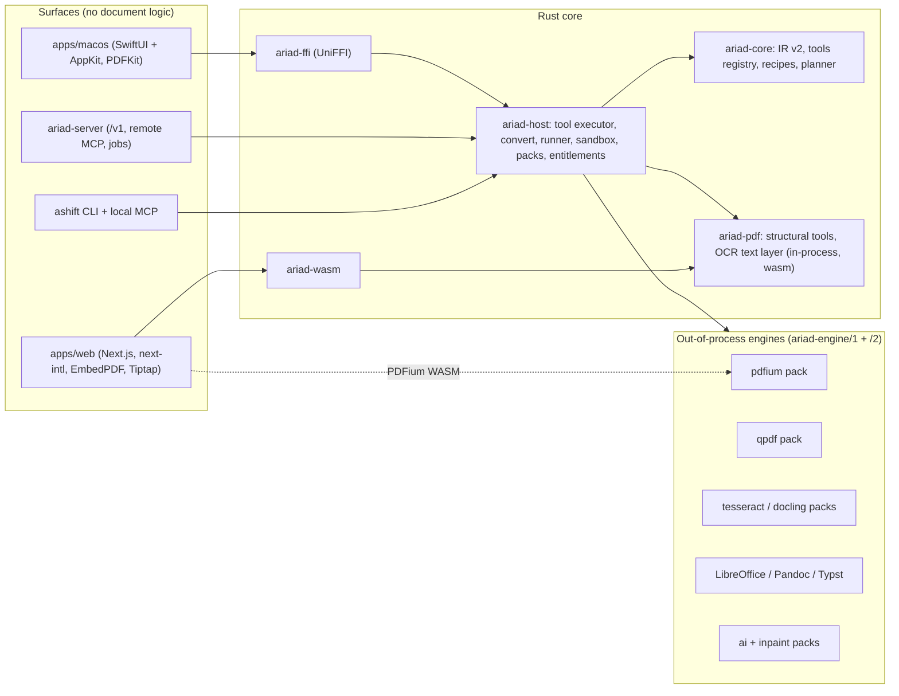

# Next stage: PDF suite → Web → native macOS

Accepted direction: [brainstorm contract](../reports/brainstorm-261031-2108-next-stage-product-direction.md) (owner decisions D1-D14). Working model: [coordinator protocol](./coordinator-protocol.md). Starts after v0.2.0 ships (v1-completion phase 3).

## Overview

AriadShift today converts documents (36 routes, shared IR, CLI/MCP/web/desktop/cloud) but has **no PDF manipulation at all** and **no native macOS code**. This plan adds a permissive PDF tool engine (pure-Rust `ariad-pdf` in-process + PDFium/qpdf/Tesseract out of process over a new `ariad-engine/2`), then the web app and a SwiftUI/AppKit macOS app on top, with the gem — **edit any PDF or scan like a Word document**, in Document (reflow) and Page (in-place) modes — and offline-first AI and automation. 1.0 ships only at full parity (D6), with public 0.x previews at each milestone (D7).

## Evidence

| Report | Use |
|---|---|
| [Stirling-PDF teardown](../reports/researcher-261031-2046-stirling-pdf.md) | Feature inventory, complaints, gaps |
| [BentoPDF teardown](../reports/researcher-261031-2046-bentopdf.md) | Tool inventory, correctness failures, AGPL boundary |
| [Native macOS + market](../reports/researcher-261031-2046-macos-native-and-market.md) | SwiftUI + UniFFI, Developer ID + Sparkle |
| [UI surface tech](../reports/researcher-261031-2115-ui-surface-tech.md) | next-intl, EmbedPDF, Tiptap, Xcode 27.2, UniFFI 0.32.2, Sparkle 2.10.1 |
| [Permissive PDF engine stack](../reports/researcher-261031-2113-permissive-pdf-engine-stack.md) | lopdf, PDFium, qpdf, Tesseract, signing, PDF/A |
| [Watermark removal](../reports/researcher-261031-2056-watermark-removal.md) | Level 1 lopdf+PDFium, Level 2 Florence-2+OpenCV (LaMa gated) |
| Repo scout (2026-10-31, summarised in phase 1/2 "Context") | Extension points with file:line |

## Phases

| # | Phase | Milestone | Depends on | Status |
|---|---|---|---|---|
| 1 | [Architecture contracts, parity matrix, test corpus](./phase-01-architecture-contracts-and-parity-matrix.md) | A | — | Completed |
| 2 | [Tool framework + `ariad-engine/2` (pdf.info skeleton)](./phase-02-tool-framework-and-engine-protocol-v2.md) | A | 1 | Completed |
| 3 | [Structural PDF tools (25 tools, wasm)](./phase-03-structural-pdf-tools.md) | A → 0.3.0 | 2 | Pending |
| 4 | [PDFium engine: render, images, text](./phase-04-pdfium-engine-render-and-images.md) | B | 2 | Pending |
| 5 | [Optimize and security (compress, qpdf, sanitize)](./phase-05-optimize-and-security.md) | B | 3, 4 | Pending |
| 6 | [Overlays and watermarks (add + remove L1)](./phase-06-overlays-and-watermarks.md) | B | 3, 4 | Pending |
| 7 | [OCR and scan tools](./phase-07-ocr-and-scan-tools.md) | B | 4 | Pending |
| 8 | [Annotations and forms](./phase-08-annotations-and-forms.md) | B | 4 | Pending |
| 9 | [Redaction and signatures](./phase-09-redaction-and-signatures.md) | B | 4, 5 | Pending |
| 10 | [Conversion parity, PDF/A-UA, compare](./phase-10-conversion-parity-compliance-compare.md) | B → 0.4.0 (with 14) | 4, 7 | Pending |
| 11 | [IR styles (`ariad-ir/2`) + fidelity score](./phase-11-ir-styles-and-fidelity-score.md) | C | 10 | Pending |
| 12 | [Edit engine: Document + Page mode](./phase-12-document-and-page-edit-engine.md) | C | 11, 8 | Pending |
| 13 | [Automation, recipes, offline AI, cloud tool jobs, watermark L2](./phase-13-automation-recipes-and-ai.md) | C → 0.5.0 (with 15) | 12, 6, 7 | Pending |
| 14 | [Web foundation: shell, i18n 40+, viewer](./phase-14-web-foundation-i18n-viewer.md) | D (parallel with 5-13) → 0.4.0 | 3, 4 | Pending |
| 15 | [Web tool suite](./phase-15-web-tool-suite.md) | D → 0.5.0 | 14, 10 | Pending |
| 16 | [Web editor + AI panel](./phase-16-web-editor-and-ai.md) | D → 0.6.0 | 15, 12, 13 | Pending |
| 17 | [macOS foundation: ariad-ffi, shell, viewer, Sparkle](./phase-17-macos-foundation-ffi-shell.md) | E | 16 | Pending |
| 18 | [macOS tools + editor](./phase-18-macos-tools-and-editor.md) | E → 0.7.0 | 17 | Pending |
| 19 | [macOS native integrations](./phase-19-macos-native-integrations.md) | E → 0.8.0 | 18 | Pending |
| 20 | [Hardening, benchmarks, 1.0 launch](./phase-20-hardening-benchmarks-and-1-0-launch.md) | F → 1.0.0 | 19 | Pending |

Parallelism: after phase 4, engine phases 5-8 run concurrently and the **web foundation (14) runs alongside them** (owner decision 2026-10-31: web starts once structural tools + PDFium exist). Web tool UIs (15) start after engine parity (10); the web editor (16) after the edit engine (12, 13). macOS (17-19) starts after the web editor. Concurrent phases follow the integration rule in the coordinator protocol: one integration owner regenerates shared/generated files per wave, and a red `dev` blocks new phase worktrees.

## Architecture at a glance

## Release cadence (D7; every tag needs the owner's GO)

| Version | After phase | Contents |
|---|---|---|
| 0.3.0 | 3 | CLI/MCP/crates: tool framework + 25 structural tools |
| 0.4.0 | 10 + 14 | Engine parity (render, optimize, security, overlays, OCR, forms, redaction, signatures, conversion, compare) + web preview (new shell, 40+ locales, viewer, browser tools) |
| 0.5.0 | 13 + 15 | IR styles, edit engine, recipes, offline AI, cloud tool jobs + every tool in the web UI |
| 0.6.0 | 16 | Web editor (Document/Page modes) + AI panel |
| 0.7.0 | 18 | macOS preview |
| 0.8.0 | 19 | macOS integrations |
| 1.0.0 | 20 | Web + macOS 1.0 |

Packs (`pdfium`, `qpdf`, `tesseract`, `sign`, `verapdf`, `ai`, `inpaint`) are versioned `0.x` and declared unstable until `ariad-engine/2` is final in phase 20; each manifest carries `engine_protocol`.

## Success criteria

- [ ] Every row of `docs/parity-matrix.md` (Stirling + Bento union + beyond-parity list) implemented and tested on web and macOS.
- [ ] Correctness proofs green: verified redaction, valid signatures after save, diacritics survive edit/OCR, tables survive PDF→DOCX/XLSX.
- [ ] Fidelity benchmark published and ≥ Stirling on text/table, ≥ +10 % style accuracy (phase 11).
- [ ] Footprint benchmark published vs Stirling desktop (phase 20).
- [ ] 40+ locales shipped; EN/VI reviewed.
- [ ] No AGPL/non-OSI code in any artifact; `just deny`, `just licenses-check`, `just js-licenses` green.
- [ ] Web 1.0 and notarized macOS 1.0 released with the owner's GO.

## Dependencies

- Blocked by: `261025-1651-ariadshift-v1-completion` phase 3 (v0.2.0 release) only. Its phases 7 and 8 (on hold) are folded into phase 20 here.
- Owner inputs needed during the plan: Pro tool list (phase 1 gate), Weblate host (phase 14), Apple signing/notarization secrets and Sparkle EdDSA key (phase 17), LaMa/AI weight licence approvals (phase 13), every release GO.

## Red Team Review

### Session — 2026-10-31
**Findings:** 39 raw → 26 clusters (26 accepted, 0 rejected; #15 accepted with modification). Report: [red-team-261031-2208](../reports/red-team-261031-2208-next-stage-plan.md).
**Severity breakdown:** 6 Critical, 15 High, 5 Medium.
**Owner decisions folded in (2026-10-31):** apply all; keep menu-bar extra and recipe Quick Look, drop Share/Action extension; URL→PDF = host fetch + offline render; web foundation runs in parallel from phase 4.

| # | Finding | Severity | Applied to |
|---|---|---|---|
| 1 | Runner `/2` drops limits/sandbox roots; no handshake; 1 MiB line | Critical | P1 AD-3, P2 T2/T4 |
| 2 | Secrets contract too late; recipes/URLs/DB leak | Critical | P1 AD-16, P2 T1/T5/T6, P5, P13, P15 |
| 3 | Redaction scrub incomplete; shared-blind-spot verifiers; OPFS history | Critical | P9, P16 |
| 4 | Registry crate cycle; non-deserializable ToolId | Critical | P2 T1, P3 |
| 5 | Tool output bypasses confinement; non-atomic multi-artifact | Critical | P2 T5 |
| 6 | Engine network allowlist impossible → SSRF | Critical | P1 AD-15, P9, P10 |
| 7 | lopdf strips owner-password encryption | High | P1 T5, P2 T3 |
| 8 | Bounded open invents Limits fields | High | P2 T3 |
| 9 | Cloud cannot run tool jobs | High | P2, P4, P13 T7 |
| 10 | Entitlements bypassed in WASM; name clash; exit codes | High | P1 AD-9, P2 |
| 11 | Stateful Page-mode sessions impossible | High | P1 AD-17, P4 T1, P12 |
| 12 | `ir-patch/1` has no consumer | High | P12, P16 |
| 13 | Pack trust/versioning gaps | High | P2 T4, P4 |
| 14 | No generic pack-engine resolution | High | P2 T4 |
| 15 | Three engine crates duplicate the adapter pattern | High | P1 AD-14, P4, P5, P7 |
| 16 | Concurrent phases collide on shared/generated files | High | plan, protocol, P2, P3 |
| 17 | Release/CI wiring (publish order, ci-scope) | High | P2 T8, P3 |
| 18 | Web locale move breaks consumers; Safari isolation; budget | High | P2 T7, P14 |
| 19 | P10 formats / multi-output routes / regeneration race | High | P10 |
| 20 | IR v2 blast radius; positional layout keys; thin fixtures | High | P11, P16 |
| 21 | Untrusted recipes and deep links | High | P1 AD-18, P2, P15, P19 |
| 22 | `sign` pack supply chain; committed test keys | High | P9, P20 |
| 23 | MCP additions break exhaustive tests | Medium | P2 T6, P13 |
| 24 | Hand-offs before the Mac app | Medium | P14, P15 |
| 25 | macOS signing secrets gating; Sparkle key | Medium | P17 |
| 26 | Duplicate watcher; unrequested Mac extensions; hidden pack effort | Medium | P7, P9, P10, P17, P19 |

### Whole-Plan Consistency Sweep
Swept all 22 plan files for superseded terms after applying the findings: standalone qpdf/tesseract engine crates, `ir-patch`, MCP `list_tools`/`run_tool` names, `Cloud` in default runtimes, `entitlements::allows`, pack `ocr`, engine sessions for edits, headless Chromium, the `AriadShift/packs` macOS path, the old 0.6-0.9 preview numbers and full local `just ci` gates. Remaining hits are intentional: the AD-15/AD-17 rows name the rejected options, and the red-team table names the original findings. No unresolved contradictions.

## Validation Log

### Session — 2026-10-31
| Question | Owner answer | Applied to |
|---|---|---|
| Minimum macOS | macOS 15+, Apple Intelligence features gated to 26+ (offline `ai` pack below 26) | P17, P18 |
| Tauri app | Maintenance only; macOS build retired at 0.7.0; Windows/Linux keep Tauri until native apps | P1 AD-8 |
| JBIG2 | Not shipped this stage; revisit with a patent/legal check in phase 20 | P5, P20 |
| Translation platform | Hosted Weblate (free libre/OSS plan), git-synced | P14, `docs/i18n.md` (P1 T4) |
| Red-team findings | Apply all 26 | All phases |
| Mac extras | Keep menu-bar extra + recipe Quick Look; drop Share/Action extension | P19 |
| URL→PDF | Host fetch + offline render (no headless browser) | P1 AD-15, P10 |
| Web timing | Web foundation runs in parallel from phase 4 | P14, plan |

Remaining owner inputs during execution: Pro tool list (P1 gate), exact locale list (P1 T4), Weblate project creation (P14), Apple signing/notarization + Sparkle keys (P17), LaMa and AI weight licences (P13), every release GO.
